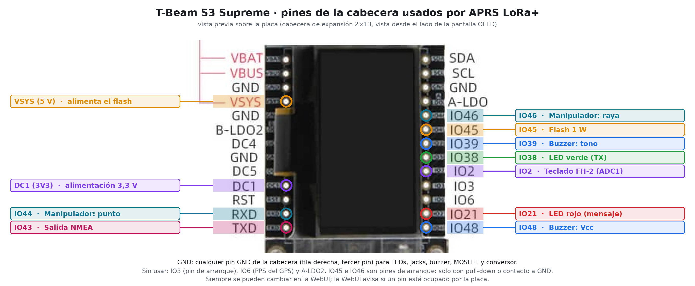
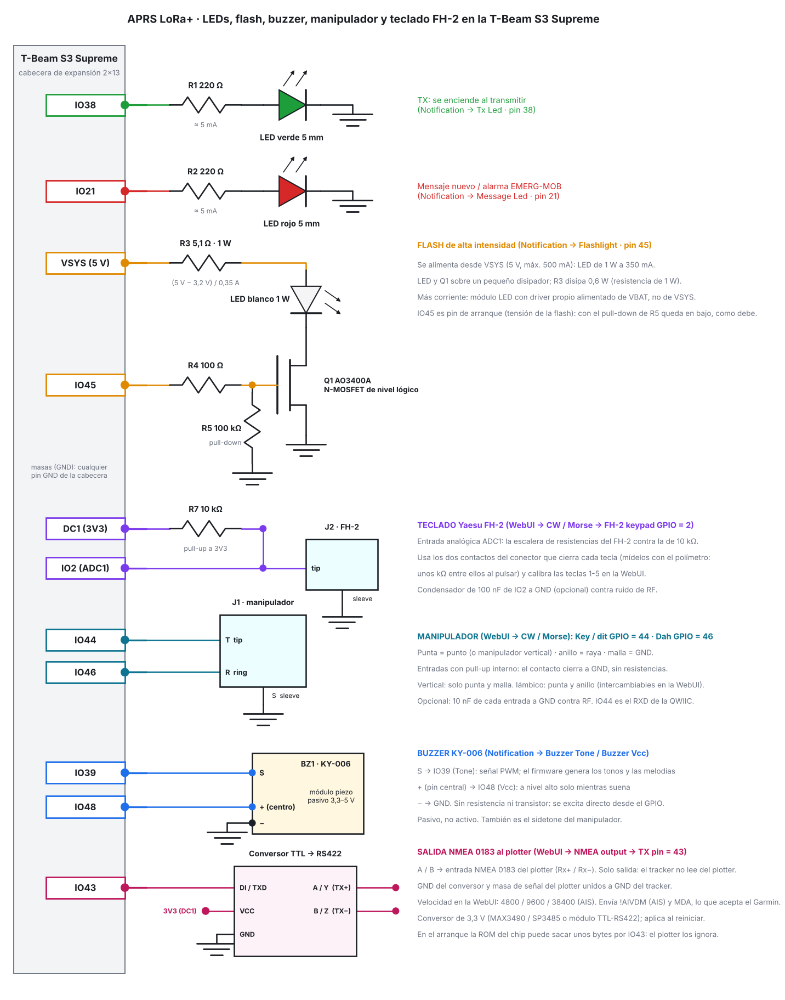

# T-Beam S3 Supreme: LEDs, flash, buzzer, manipulador, teclado FH-2 y salida NMEA

Copyright (C) 2026 Manuel - EA7JRS. Esquema y reparto de pines para añadir hardware externo a la **T-Beam S3 Supreme** con APRS LoRa+. Todo se configura en la WebUI; en la Supreme, la WebUI identifica cada pin (libre / a evitar / ocupado por la placa) y avisa si repites uno. El firmware rechaza (y deja desactivada la función) un pin que use la propia placa.

## Reparto de pines (cabecera de expansión 2×13)

| Función | GPIO | Cabecera | WebUI | Notas |
|---|---|---|---|---|
| LED verde (TX) | 38 | IO38 | Hardware → Notification → *Pin used for Tx Led* | 220 Ω en serie |
| LED rojo (mensaje / alarma) | 21 | IO21 | *Pin used for Message Rx Led* | 220 Ω en serie |
| Flash de alta intensidad | 45 | IO45 | *Pin used for Flashlight Pin* | MOSFET de nivel lógico; LED desde VSYS (5 V) |
| Buzzer, tono | 39 | IO39 | *Buzzer Tone Pin* | módulo **KY-006** (piezo pasivo), pin **S** |
| Buzzer, Vcc | 48 | IO48 | *Buzzer Vcc Pin* | pin **+** (central) del KY-006; a nivel alto solo mientras suena |
| Teclado Yaesu FH-2 | 2 | IO2 (ADC1) | Transmission mode → CW / Morse → *FH-2 keypad ADC GPIO* | 10 kΩ a 3V3 (pin DC1) |
| Manipulador, punto / vertical (punta) | 44 | RXD (QWIIC) | *Key / dit GPIO* | contacto a GND, pull-up interno |
| Manipulador, raya (anillo) | 46 | IO46 | *Dah GPIO* | contacto a GND, pull-up interno |
| Salida NMEA hacia el conversor TTL→RS422 | 43 | TXD (QWIIC) | Connectivity → *NMEA output* → *TX pin* | aplica al reiniciar; 4800 / 9600 / 38400 baud |

Sin usar: IO3 (pin de arranque), IO6 (PPS del GPS) y A-LDO2. Los defaults de fábrica de LEDs, flash y buzzer en la Supreme son 38 / 21 / 45 / 39 / 48 (todo apagado); manipulador, teclado y NMEA vienen sin pin (-1). El botón *Use the suggested pins* de la WebUI rellena todos con esta tabla.

## Por qué estos pines

- La Supreme tiene casi todo el resto de GPIO ocupado: radio SX1262 (1, 4, 5, 10–13), GPS (7–9; 6 = PPS), IMU y SD (33–37, 47), PMU y RTC (14, 40–42), I2C de OLED y sensores (17, 18), USB (19, 20) y flash/PSRAM (26–32). La cabecera deja libres 2, 3, 21, 38, 39, 43–46 y 48.
- **FH-2 en IO2:** el teclado necesita una entrada analógica **ADC1** (GPIO 1–10 en el ESP32-S3; el ADC2 no vale con el WiFi encendido). El IO2 es el único ADC1 libre de la cabecera.
- **IO43 / IO44** son TXD / RXD de la toma QWIIC. Como el USB de la Supreme es nativo (CDC), no se usan para el log y quedan libres; no los uses a la vez con un dispositivo QWIIC.
- **IO45 / IO46** son pines de arranque. Solo se usan con un **pull-down** (puerta del MOSFET) o con un **contacto a GND** (manipulador), que es el estado por defecto durante el arranque. No pongas ahí una señal que repose en alto. IO3 también es de arranque y no se usa.
- Idéntico criterio para el NMEA: el TX en reposo va en alto, así que va a IO43 (UART) y no a un pin de arranque. La ROM del chip puede sacar unos bytes por IO43 al arrancar; el plotter los ignora.

## Notas por bloque

- **LEDs:** 220 Ω da unos 5 mA a 3,3 V; para más brillo baja a 150 Ω (máx. 12 mA por GPIO).
- **Flash:** LED blanco de 1 W (Vf ≈ 3,2 V, 350 mA) desde VSYS (5 V, máx. 500 mA) con R3 = 5,1 Ω / 1 W; Q1 = AO3400A (o IRLML6344), R4 = 100 Ω, R5 = 100 kΩ. LED y Q1 sobre un pequeño disipador. Para más corriente, módulo LED con driver propio alimentado de VBAT. Es una salida encendido / apagado.
- **Buzzer:** módulo **KY-006** (piezo **pasivo**, 3,3–5 V; el firmware genera tonos y melodías, uno activo solo da un tono fijo). Conexión: **S → IO39**, **+** (pin central) **→ IO48**, **−** → GND. Sin resistencia ni transistor: el módulo se excita directo desde el GPIO. Con IO48 el módulo solo recibe alimentación mientras suena; si tu módulo no tiene el pin central conectado, deja IO48 libre, no afecta. Antes de conectar, comprueba con el polímetro que el pin central y S no están unidos entre sí (según el fabricante el central va a + o está al aire). También es el sidetone del manipulador.
- **FH-2:** conecta el teclado entre IO2 y GND con 10 kΩ de IO2 a 3V3 (DC1). Mide con el polímetro los dos contactos del conector que cierra cada tecla y calibra las teclas 1–5 en la WebUI (ver `CW_MORSE.md`). 100 nF de IO2 a GND ayuda contra RF.
- **Manipulador:** jack de 3,5 mm: punta = punto (o manipulador vertical), anillo = raya, malla = GND. 10 nF de cada entrada a GND contra RF (opcional).
- **NMEA:** IO43 → DI/TXD del conversor; VCC del conversor a 3V3 (DC1) si es de 3,3 V; GND común; A/B (o Y/Z) → entrada NMEA 0183 del plotter (Rx+ / Rx−) con la masa de señal unida. Solo salida. Se envían las sentencias que acepta el Garmin por NMEA 0183: `!AIVDM` y `MDA`.

Los datos del reparto de pines de la cabecera proceden del esquema oficial de LilyGO (fila derecha: SDA, SCL, GND, A-LDO2, IO46, IO45, IO39, IO38, IO2, IO3, IO6, IO21, IO48; fila izquierda: VBAT, VBUS, GND, VSYS, GND, B-LDO2, DC4, GND, DC5, DC1, RST, RXD, TXD). Comprueba tu placa antes de soldar.
