# LoRa APRS Tracker V5.4.1 — Manual de usuario

**Placa de referencia:** LilyGO T-Beam S3 Supreme (ESP32-S3, SX1262, GPS u-blox M10, pantalla OLED 128×64)
**Base:** LoRa APRS Tracker V4.0.1 de CA2RXU, con las mejoras para T-Beam S3 Supreme y la interfaz de pantallas APRS de EA7JRS.
**Novedades de la 5.4.1:** apartado 37. **De la 5.4.0:** apartado 36. **De la 5.3.4 y la 5.3.5:** apartados 34 y 35. **Novedades de la 5.2.1:** LAST APRS muestra el icono del símbolo APRS de la estación; ALTIMETER marca velocidad vertical 0 con el tracker parado. **De la 5.2.0:** modo **WSPR beacon** (capítulo 22). **De la 5.1.0:** selector de modo al arrancar (APRS LoRa / APRS FSK 9600 / MORSE), FSK 9600 AX.25 G3RUH, plan de bandas IARU en la WebUI y modo MORSE con macros, manipulador, escucha CW y trainer (capítulos 19 a 21).
**Documentos relacionados:** `GUIA_RAPIDA.md` (una página), `releases/RELEASE_5.1.0.md` (novedades y cambios), `APRS_PANTALLAS_TRACKER.md` (notas técnicas y estado de pruebas).

> Las imágenes de este manual son **capturas simuladas** (se dibujan en un simulador de 128×64 con el mismo código de las pantallas, no son fotos de la placa real).

---

## 1. Introducción

Esta versión sustituye la pantalla de información del Tracker por una interfaz de **11 páginas** al estilo Meshtastic, pensada para manejarse con **un solo botón** y para ser legible en una OLED de 128×64. Todo lo que ya hacía el Tracker (balizas, SmartBeaconing, mensajes, digipeater, perfiles, AIS, menú de configuración) sigue funcionando igual; las pantallas lo muestran y añaden herramientas nuevas: lista de estaciones con GO TO, brújula con declinación WMM, altímetro con QNH, reloj con orto y ocaso, estado de radio, pronóstico meteorológico, alarmas de emergencia y baliza SOS.

**Qué necesitas:**
- Una placa con pantalla y botón de usuario. Las pantallas están activas en todas las placas con pantalla salvo `HELTEC_WSL_V3_TNC` (sin pantalla). Algunas funciones (SOS por botón) requieren `BUTTON_PIN`.
- Para algunas páginas hace falta hardware concreto: barómetro/humedad (BME280, BMP280 o BME680) para TELEMETRY y el QNH barométrico; magnetómetro e IMU para la brújula con la placa quieta; RTC para la hora sin GPS. Sin ellos la página lo indica (`---`, `no sensor`).

---

## 2. Manejo

### 2.1 El botón

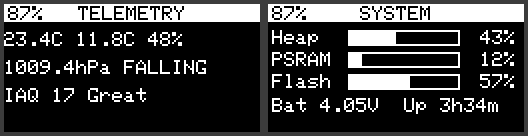

| Gesto | Pantalla normal | Submenú abierto |
|---|---|---|
| **1P** — pulsación corta | Siguiente página | Siguiente opción del submenú |
| **LP** — pulsación larga | Abre el submenú de la página | Ejecuta la opción marcada |
| **2P** — doble pulsación | Menú clásico de configuración | Cierra el submenú |
| **3 o 4 pulsaciones** | Menú de WiFi AP (como en el Tracker original) | — |
| **5 cortas, o SOS en morse** | Baliza de emergencia (§9) | — |

Con un teclado (T-Deck, etc.) las flechas arriba/abajo hacen de página anterior/siguiente.

Reglas generales:
- Desde el **menú clásico**, 2P vuelve a las pantallas.
- Un submenú se cierra solo a los 10 s sin pulsar.
- En listas con cursor (MESSAGES y STATIONS en modo *Browse*): 1P mueve el cursor, LP abre/ejecuta, 2P sale.
- *Display off* (en MAIN) apaga la pantalla a mano; una pulsación vuelve a encenderla.

### 2.2 Cabecera y barra de iconos

- **Cabecera:** a la izquierda el **% de batería**; en el centro el **título** de la página; a la derecha una **etiqueta** según la página (modo de baliza, región LoRa, fuente de hora, tipo de fix…). Si hay una emergencia en curso, «SOS» parpadea ahí en todas las páginas.
- **Barra de iconos** (abajo): aparece al cambiar de página y se oculta sola a los 3 s. Resalta la página actual.
- **Avisos breves** (recuadro en el centro): confirmaciones como «Counters reset» o «SOS sent #1».

### 2.3 Pantalla de bienvenida y selector de modo

Al arrancar: logo «APRS LoRa+», **CA2RXU** arriba a la izquierda, la **versión** arriba a la derecha y debajo tu **indicativo sin SSID**.

Después aparece **SELECT MODE** (ver capítulo 19): *APRS LoRa*, *APRS FSK 9600*, *MORSE / CW* o *WSPR beacon*. Pulsación corta = siguiente, larga = aceptar; sin pulsar, a los 8 s arranca el último modo APRS usado.

### 2.4 Orden de las páginas

MAIN → MESSAGES → LAST APRS → STATIONS → GPS → COMPASS → ALTIMETER → TELEMETRY → CLOCK → LORA → SYSTEM → (vuelve a MAIN). Es el orden de los dos modos APRS. El modo MORSE tiene una única pantalla (capítulo 21).

### 2.5 Ajustes que se recuerdan

Se guardan en la memoria flash y sobreviven a un reinicio: unidades, formato de coordenadas, modo de rumbo, norte verdadero/magnético, declinación, zona horaria y formato de hora (`/pagesCfg.dat`); constelaciones GNSS (ahora en la sección GPS de la WebUI, ya no en `/gps_gnss.dat`); potencia de LoRa por perfil (`/loraPower.dat`); y el historial de mensajes (`/aprsMsgLog.txt`). La lista de estaciones oídas **no** se guarda (vive en RAM).

---

## 3. MAIN — pantalla principal

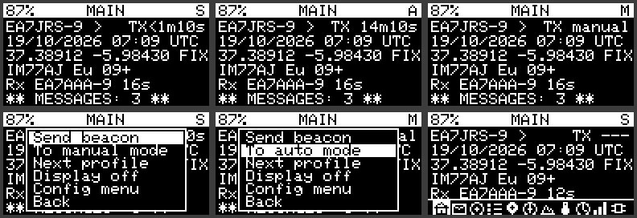

| Fila | Contenido |
|---|---|
| 1 | Indicativo y símbolo; a la derecha la **cuenta atrás** de la próxima baliza (`TX 14m10s`; `<` = con SmartBeaconing puede salir antes; `TX manual`; `TX now`) |
| 2 | Fecha y hora UTC |
| 3 | Posición del GPS (`FIX` si hay fix, `~` si es la última conocida, `WAITING FOR GPS`, `GPS SLEEP`) |
| 4 | Locator Maidenhead de 6 caracteres, región LoRa (Eu, PL, UK, US, AIS) y satélites con calidad HDOP (`+` buena, `-` regular, `X` mala) |
| 5 | Última estación recibida y hace cuánto |
| 6 | `** NEW MSG: n **` si hay mensajes sin leer; si no, altitud, velocidad y rumbo |

**Etiqueta de la cabecera:** **A** = balizas automáticas, **S** = SmartBeaconing, **M** = manual.

**Submenú (LP):**
- **Send beacon** — transmite una baliza ahora.
- **Beacon mode** — alterna entre automático/SmartBeaconing y manual. En manual no sale ninguna baliza automática.
- **Next profile** — siguiente perfil de baliza (indicativo/SSID).
- **Send SOS** — inicia la cuenta atrás de la baliza de emergencia (§9). Durante una emergencia aparece **Cancel SOS** al principio.
- **Display off** — apaga la pantalla.
- **Config menu** — menú clásico de configuración.

---

## 4. MESSAGES — mensajes

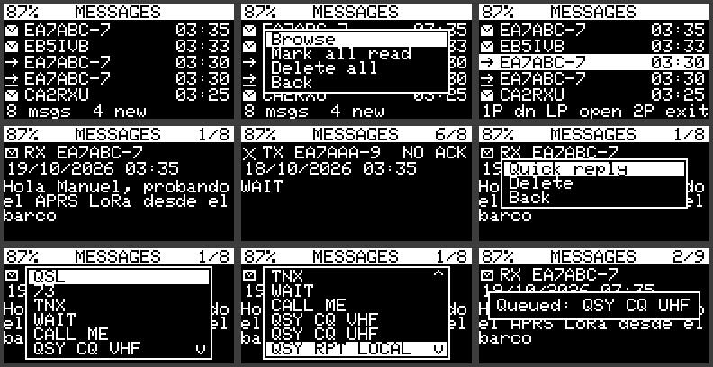

Lista de mensajes **recibidos y enviados**, el más reciente arriba, con hora. Iconos: sobre = recibido; flecha = enviado; los enviados indican si fueron confirmados o `NO ACK`. Abajo: total y nuevos. El LED de mensaje se apaga al leer los que estaban pendientes.

**Submenú de la lista (5.2.12):** **Read / reply** (abre ya el mensaje recibido sin leer más reciente, o el último recibido), *Browse list* (cursor), *Mark all read*, *Delete all*. Abajo, la lista indica `N new  Hold: read`. **Para contestar:** LP (menú) → LP en *Read / reply* → LP (menú del mensaje) → *Quick reply* → 1P elige el texto → LP envía. Funciona igual en APRS LoRa y APRS FSK.
**En *Browse*:** 1P baja, LP abre el mensaje, 2P sale.
**Detalle del mensaje** (con texto en varias líneas): **Reply** (solo con teclado: abre la escritura con el destinatario puesto), **Quick reply**, **Delete**.

**Respuestas rápidas:** QSL, 73, TNX, WAIT, CALL ME, QSY CQ VHF, QSY CQ UHF, QSY RPT LOCAL. Se envían **pidiendo confirmación** y aparecen en la lista como enviados.

Cuando llega un mensaje se oye el pitido de mensaje (si está activado) y el LED parpadea hasta que lo lees.

---

## 5. LAST APRS — última estación oída

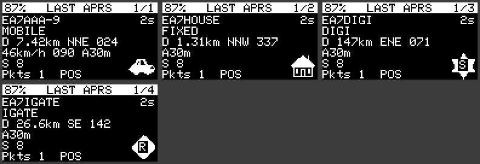

Muestra la última estación recibida (se puede navegar hacia las anteriores). Tiene **dos vistas** (opción *Next view*):

- **Vista 1:** indicativo, antigüedad, tipo (MOBILE, FIXED, OBJECT, WX, DIGI, IGATE…), equipo (por el tocall o el sufijo Mic-E, según la lista oficial aprs-deviceid de Hessu OH7LZB, CC BY-SA 2.0: p. ej. *Yaesu FT5D*), distancia y rumbo desde ti, y en la esquina inferior derecha el **icono APRS** del símbolo de la estación (tablas primaria y secundaria, con la letra o el dígito de superposición en el centro; si la estación no ha enviado símbolo se dibuja una mini brújula hacia ella), velocidad/rumbo/altitud si es móvil, S-meter (`S 8`, `S 9+10`), nº de paquetes y estado (en Mic-E: *In Service*, *Emergency!*…).
- **Vista 2:** indicativo, locator, coordenadas, comentario completo (con salto de línea) y el camino (`via WIDE1-1*`). Para estaciones meteorológicas muestra T, Hr, presión, viento y lluvia.

**Submenú:** *Next view*, *Older station*, *Newer station*, **GO TO** (§7), *Back*.

---

## 6. STATIONS — estaciones oídas

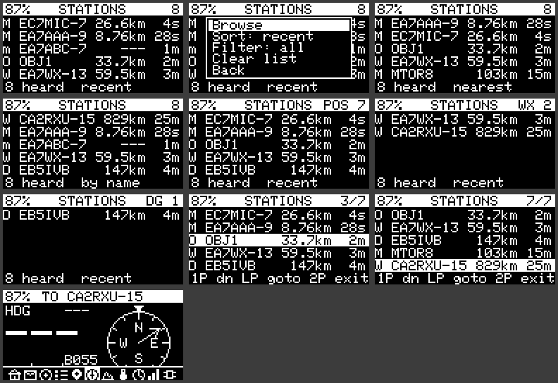

Lista de hasta **20 estaciones** con una letra de tipo, indicativo, distancia y antigüedad. Letras: **M** móvil, **F** fija, **O** objeto, **W** meteorológica, **D** digipeater, **I** iGate, **m** solo mensajes, **s** estado, **t** telemetría. La cabecera indica el filtro activo y el número de estaciones; abajo el orden.

**Submenú:**
- **Browse** — cursor sobre la lista (1P baja, **LP = GO TO** a la estación marcada, 2P sale).
- **Sort** — *recent*, *nearest* (más cercana) o *by name*.
- **Filter** — *all*, *position* (solo con posición), *mobile*, *fixed*, *WX*, *digi*.
- **Clear list** — borra la lista.

Un paquete sin posición (un mensaje, un estado) **no** borra la última posición conocida de esa estación. Las estaciones sin posición se muestran con `---` en distancia.

---

## 7. GO TO — ir hacia una estación

GO TO abre **COMPASS** con la estación como destino. Se puede lanzar desde LAST APRS, desde STATIONS (modo *Browse*) y desde la pantalla de alarma de emergencia. La cabecera pasa a `TO <indicativo>` y la brújula muestra rumbo (`B055`), distancia y tiempo estimado de llegada. Al llegar a **menos de 50 m** suena un pitido; se rearma al alejarte de 80 m. Si la estación no tiene posición conocida, aparece «Station has no position».

---

## 8. GPS

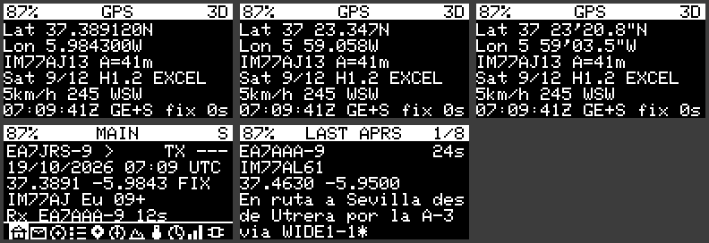

| Fila | Contenido |
|---|---|
| 1 | Latitud (en la formato elegido; **DD con 6 decimales** solo en esta página, 4 en el resto) |
| 2 | Longitud |
| 3 | Locator de 8 caracteres y altitud (`A=41m`, barométrica o GPS) |
| 4 | Satélites usados/vistos, HDOP, calidad según el HDOP (IDEAL, EXCEL, GOOD, MODER, FAIR, POOR) |
| 5 | Velocidad y rumbo con punto cardinal |
| 6 | Hora UTC, constelaciones activas (`GE+S` = GPS + Galileo + SBAS) y edad del fix |

La cabecera indica el tipo de fix (`3D`, `2D`, `NO FIX`).

**Submenú:**
- **GPS on/off** — enciende o apaga el receptor a mano (ahorra batería).
- **Coords** — formato: **DD** (37.389120N), **DDM** (37 23.347N) o **DMS** (37 23'20.8"N).
- **Units** — **metric**, **imperial** o **nautical**. Afecta a todas las páginas (distancias, velocidades, altitudes).
- **SBAS** — activa o desactiva SBAS (EGNOS).
- **Constellations** — GPS, Galileo, BeiDou, GLONASS, QZSS (cada una se activa/desactiva y se guarda).

> Cambiar de constelación reinicia el receptor: puedes perder el fix unos segundos. Funciones GNSS, SBAS y constelaciones disponibles en el u-blox M10 de la Supreme.

---

## 9. COMPASS — brújula

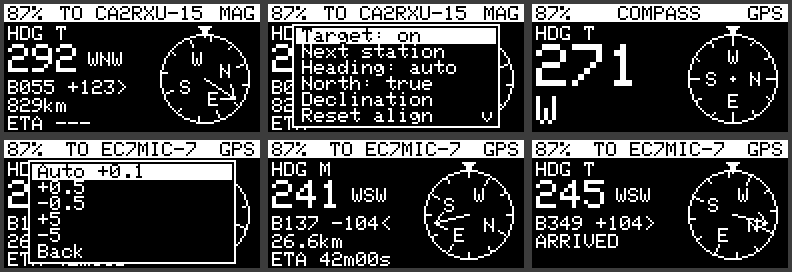

Rosa de los vientos con el rumbo arriba. Sin destino muestra el rumbo propio; con destino (GO TO o *Target: on*) muestra además una flecha hacia la estación, el **rumbo (B)**, el **error de rumbo** respecto a tu dirección (`+123>` gira a la derecha, `-104<` a la izquierda), la distancia y el **ETA**. `ARRIVED` al llegar.

El rumbo se obtiene fusionando el **giroscopio**, el **magnetómetro** y el **rumbo GPS** (con velocidad suficiente). La etiqueta de la cabecera dice la fuente: `MAG`, `GPS`.

**Submenú:**
- **Target** — activa o desactiva el destino.
- **Next station** — cambia de estación destino.
- **Heading** — *auto* (fusión), *MAG* (solo magnetómetro) o *GPS* (solo rumbo GPS).
- **North** — norte **verdadero** (`T`) o **magnético** (`M`).
- **Declination** — abre un segundo nivel: modo **Auto** (modelo **WMM2025**, con tu posición y fecha) o manual, con ajustes de ±0,5° y ±5°.
- **Reset align** — olvida el desfase de alineación aprendido del magnetómetro («Alignment reset»).

La declinación automática usa el modelo WMM2025 (válido hasta ~2030). Si no hay posición o fecha, se usa la manual.

---

## 10. ALTIMETER — altímetro

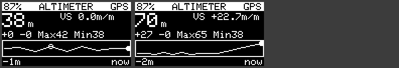

- **Altitud** grande, **velocidad vertical** (`VS -1.1m/m`; con el tracker parado más de 10 s, según el GPS (< 1,5 km/h) o el acelerómetro, marca `VS 0.0m/m` en lugar del ruido del barómetro o del GPS) y **QNH** en uso (con `*` si es manual).
- **Ascenso/descenso** acumulados (`+151 -122`) y máximo/mínimo (`H56 L-13` o `Max56 Min-7`).
- **Perfil de altitud**: gráfico de hasta varias horas en memoria fija (resolución decreciente).
- La cabecera indica la fuente: `BARO` (barómetro corregido con GPS) o `GPS`.

**Submenú:**
- **Span** — *full* (todo el perfil), *half* (última mitad) o *10 min*.
- **Reset profile** — borra el perfil de altitud y empieza de nuevo.
- **QNH** — segundo nivel: **Auto** (se aprende del GPS) o manual (±1 y ±0,1 hPa; sirve para fijarlo con un METAR o una estación cercana). Rango 900–1090 hPa.

---

## 11. TELEMETRY — meteorología y pronóstico

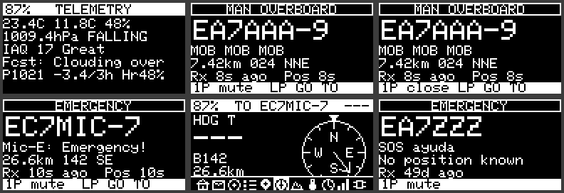

Página de sensores (necesita **Telemetry** activada en la web de configuración y un BME280, BMP280 o BME680):

| Fila | Contenido |
|---|---|
| 1 | Temperatura, punto de rocío, humedad (`23.4°C 11.8°C 48%`, centrada) |
| 2 | Presión y **tendencia barométrica** de 3 h (RISING, FALLING…) |
| 3 | Gas e **IAQ** estimado: **solo aparece con BME680**; sin él la línea se oculta y las demás suben |
| 4 | **Pronóstico** (`Fcst: Clouding over`) |
| 5 | Motivo: cambio de presión en 3 h (`-3.4 hPa/3h`; `3h trend: wait` sin historia suficiente) |
| 6 | **Base de nubes** (Hennig, (T−Td)·125 m) y tipo de aire (`Cloud 750m Cumulus`); desde las 18:00 locales, si la mínima estimada es ≤ 0 °C, `FROST risk Tmin -1°C` |
| 7 | Sin BME680 y con descenso de presión y base < 600 m: `Fog/rain likely 80%` |

**Reglas añadidas (5.2.3):** matriz de decisión con presión, cambio en 3 h y T−Td (caída fuerte < −1,5 hPa con P < 1010 y T−Td ≤ 3 → *Severe storm*; caída fuerte con P > 1020 y T−Td > 8 → *Sudden change*; estable ±0,5 con P > 1016 y T−Td > 10 → *Fair, anticyc.*; subida fuerte > +1,5 con P < 1008 y T−Td ≤ 4 → *Passing showers*), base de nubes de Hennig, tipo de aire por T−Td (≤ 3 saturado; < 10 cúmulos; ≥ 12 seco) y helada nocturna `Tmin = T18 − 0,55·(T18 − Td18) − 2` con la muestra de las 18:00 locales (necesita hora válida y que el tracker esté encendido a esa hora; vale 16 h). No se implementa el índice Z de Zambretti: su tabla de condiciones no estaba disponible.

**Cómo se calcula el pronóstico:** reglas sencillas con la presión (reducida a nivel del mar cuando se conoce la altitud), la tendencia de 3 h, la humedad y la diferencia T−Td. Resultados posibles: *Fair, stable*, *Fair*, *Fair, improving*, *Improving*, *Clearing*, *Clearing, windy*, *Little change*, *Overcast, damp*, *Turning cloudy*, *Clouding over*, *Showers possible*, *Rain likely*, *Rain/wind soon*, *Storm/gale risk*, *Fog/dew likely*, *Unsettled*. Hasta que hay tendencia (1 h de datos) muestra `(trend wait)`.

> Es un pronóstico **local y orientativo**, no un modelo meteorológico: no sustituye al parte oficial ni al de un barco o montaña.

---

## 12. CLOCK — reloj

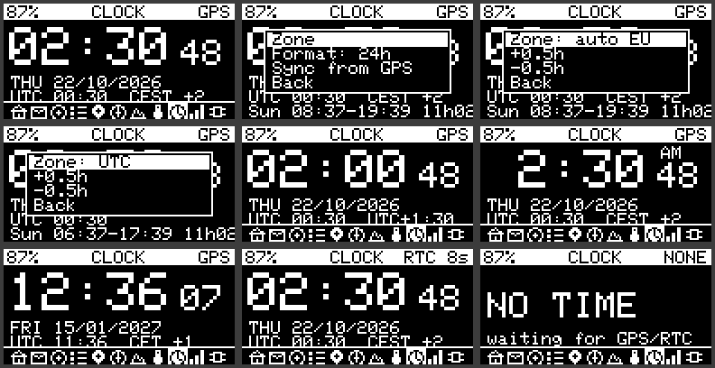

Hora local grande, segundos, fecha con día de la semana, línea de **UTC y zona** (`UTC 00:30  CEST +2`) y **orto y ocaso** con la duración del día (`Sun 08:37-19:39 11h02`, calculado con el método NOAA a partir de tu posición).

La cabecera indica la fuente de hora: `GPS`, `RTC` (con la antigüedad de la última sincronización) o `SYS`. Sin hora válida aparece `NO TIME`.

**Submenú:**
- **Zone** — segundo nivel: *auto EU* (CET/CEST con cambio horario europeo automático), *UTC* o manual (±0,5 h).
- **Format** — 24 h o 12 h (AM/PM).
- **Sync from GPS** — pone el reloj con la hora del GPS; si el GPS aún no tiene hora válida avisa «No GPS time».

---

## 13. LORA — radio

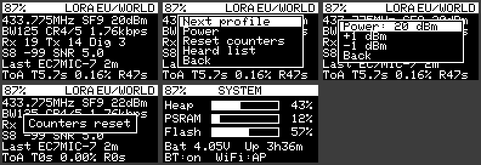

La cabecera muestra la **región/perfil** (EU/WORLD, POLAND, UK, US, CUSTOM o **AIS**, con frecuencia fija).

| Fila | Contenido |
|---|---|
| 1 | Frecuencia, factor de dispersión (SF) y **potencia** (`433.775MHz SF9 20dBm`) |
| 2 | Ancho de banda, code rate y **velocidad útil** calculada (`BW125 CR4/5 1.76kbps`) |
| 3 | Contadores `Rx n  Tx n` (y `Dig n` si el digipeater ha repetido algo) |
| 4 | **S-meter** + RSSI + SNR de la última estación (`S8 -99 SNR 5.0`) |
| 5 | Última estación recibida y hace cuánto |
| 6 | **Tiempo en el aire** de la última hora: `ToA T5.7s 0.16% R47s` (T = transmitido con su porcentaje, R = recibido) |

- **S-meter** (VHF/UHF): S9 = −93 dBm, 6 dB por punto (S1 = −141 dBm); por encima, `S9+dB`.
- **Tiempo en el aire:** se calcula con la fórmula de Semtech a partir de SF, BW, CR y la longitud real de cada trama enviada y recibida. El porcentaje de transmisión te permite vigilar el ciclo de trabajo.
- La **velocidad** es teórica (no medida).

**Submenú:**
- **Next profile** — siguiente perfil LoRa (EU/WORLD, POLAND, UK, US, CUSTOM). Bloqueado con aviso mientras el perfil de baliza AIS está activo.
- **Power** — segundo nivel con **+1 dBm** y **−1 dBm** dentro del rango válido de la placa. **Se guarda** por perfil y se aplica al arrancar.
- **Reset counters** — pone a cero Rx, Tx, Dig y el tiempo en el aire.
- **Heard list** — salta a STATIONS.

> La potencia elegida aquí manda sobre la del fichero de configuración para ese perfil. Si luego la cambias desde la web, no tendrá efecto mientras exista `/loraPower.dat` (bórralo o vuelve a ajustarla aquí).
>
> El estado de **Bluetooth y WiFi** se ve ahora en SYSTEM.

---

## 14. SYSTEM — estado del equipo

Medidores de **Heap**, **PSRAM** y **Flash** (porcentaje de uso del firmware en su partición), batería y **tiempo encendido** (`Bat 4.05V  Up 3h36m`; si la placa no tiene PSRAM activada, la fila PSRAM muestra `n/a` en lugar del porcentaje; `USB` si no hay batería) y el estado de **Bluetooth y WiFi** (`BT:on  WiFi:CON`; en BT, `CON` = móvil conectado; en WiFi, `CON` = unido a tu red con el KISS por WiFi activo, `..` = uniéndose, `AP` = punto de acceso de configuración).

- **1P** (con Bluetooth o WiFi activos) alterna a la **vista LINK**, que no es una página aparte: muestra el Bluetooth (tipo, protocolo KISS/TNC2, nombre y si hay móvil conectado) y la WiFi (red, **IP**, puertos KISS, clientes conectados y señal). Otra pulsación sigue a la página siguiente; **2P** vuelve a SYSTEM.
- **LP** abre el submenú: **Bluetooth: ON/OFF** y **BT data: KISS/TNC2** (se guardan y la placa se reinicia) **WiFi KISS: ON/OFF** y **WiFi CAT: ON/OFF** (se aplican al momento; la red WiFi se escribe en la WebUI).

---

## 15. Alarmas de emergencia recibidas

El Tracker vigila **todo lo que oye** y salta una alarma si detecta:
- una baliza **Mic-E con estado Emergency**;
- las palabras **SOS**, **EMERGENCY** o **MAYDAY** en un mensaje o comentario;
- las palabras **MOB** o **MAN OVERBOARD** (hombre al agua), con cualquier perfil activo, AIS incluido.

La detección es por **palabras completas** («MOBILE» no salta). El Tracker no decodifica mensajes AIS de radio marítima: reacciona a **mensajes APRS** que lleven esas palabras.

**Qué ocurre:** se enciende la pantalla; suena una sirena cada 2,5 s; el LED parpadea rápido; y aparece la **pantalla de alarma** con el título (`EMERGENCY` o `MAN OVERBOARD`, parpadeando), el indicativo grande, el texto del mensaje, **distancia y rumbo** (`7.42km 024 NNE`) y la antigüedad del mensaje y de la posición.

| Pulsación | Efecto |
|---|---|
| **1P** | Silencia el buzzer y el LED; una segunda 1P cierra la pantalla |
| **LP** | Silencia, cierra y hace **GO TO** hacia la estación |
| **2P** | Silencia y cierra |

- Si el mensaje no trae posición, se usa la **última posición conocida** de esa estación en STATIONS (con su antigüedad). Si no la hay, avisa «No position known» y no hay GO TO.
- La **misma estación no vuelve a sonar** hasta pasados 10 minutos desde su última alarma (sus datos se actualizan igualmente).
- El buzzer se calla solo a los 10 minutos.
- La alarma necesita **buzzer y LED de mensaje activados** en la configuración para sonar y parpadear.
- Si tienes abierto el menú clásico de configuración, la pantalla de alarma no aparece (el buzzer y el LED sí funcionan).

---

## 16. Baliza SOS propia

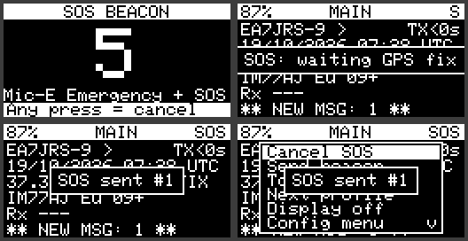

**Activación:** **5 pulsaciones cortas** o **SOS en morse** (`···  −−−  ···`) con el botón. Pulsación corta = menos de 0,3 s; larga (raya) = entre 0,3 y 0,7 s; entre pulsaciones no más de 1,2 s. También desde MAIN → LP → **Send SOS**.

**Cuenta atrás:** pantalla «SOS BEACON» con un 5 grande y pitidos cada segundo. **Cualquier pulsación la cancela.** Si no, al llegar a 0 comienza la emergencia.

**Qué se transmite** (dos paquetes seguidos, con una pausa de 1,5 s):
1. un paquete **Mic-E con estado Emergency** (estándar APRS);
2. una baliza normal de posición con el comentario **«EMERGENCY SOS»**, para quien no interprete Mic-E.

**Repetición:** cada **30 s** hasta cancelar. Durante la emergencia el GPS se mantiene **encendido** y «SOS» parpadea en la cabecera de todas las páginas. Cada envío muestra «SOS sent #n». Si aún no hay ninguna posición conocida, muestra «SOS: waiting GPS fix» y reintenta cada 5 s.

**Cancelar:** repite el gesto (5 pulsaciones o SOS en morse) o MAIN → LP → **Cancel SOS**.

Los Trackers que reciban tu emergencia mostrarán la alarma de la §15 con GO TO hacia ti.

> Probado en PC y en simulación. **No probado con el botón y la radio reales**: haz primero una prueba con otro equipo cerca, avisando a quien escuche, antes de fiarte de él.
>
> Si haces el gesto despacio, puede abrirse brevemente algún menú intermedio (por ejemplo el de WiFi AP con 3 o 4 pulsaciones); al reconocer el SOS todo vuelve a MAIN.

---

## 17. Solución de problemas

| Síntoma | Causa probable y solución |
|---|---|
| MAIN dice `WAITING FOR GPS` | Sin fix: cielo abierto y espera. Si pone `GPS SLEEP`, el GPS está apagado (modo eco o apagado a mano): GPS → LP → *GPS on/off*. |
| TELEMETRY: `Sensor: none/no data` | Activa *Telemetry* en la web de configuración y conecta el sensor. |
| Pronóstico «trend wait» | Faltan datos de tendencia (una hora como mínimo, tres para la tendencia completa). |
| La brújula no da rumbo (`no heading`) | Placa plana; con la placa quieta se usa el magnetómetro, en marcha el rumbo GPS. *Reset align* si arrastra un desfase. |
| Declinación incorrecta | Comprueba que *Declination* está en Auto y que tienes posición y fecha; si no, se usa el valor manual. |
| LORA: no me deja cambiar de perfil | El perfil de baliza activo es **AIS**, que fija su propio perfil LoRa. Cambia de perfil de baliza primero. |
| Cambié la potencia por la web y no se aplica | La potencia guardada desde las pantallas (`/loraPower.dat`) manda. Ajusta desde LORA → Power. |
| No suena la alarma | Buzzer y LED de mensaje activados en la configuración; la pantalla de alarma no aparece con el menú clásico abierto. |
| El reloj dice `NO TIME` | Sin GPS ni RTC con hora válida. Espera al fix o revisa la pila del RTC. |
| Constelaciones: pierdo el fix al cambiarlas | Es normal: el receptor se reinicia al cambiar de constelación. |
| WSPR: «NO GPS TIME» / «WAIT GPS POSITION» | Sin hora o sin posición GPS: cielo abierto. Con un locator fijo en la WebUI no hace falta posición, pero la hora sigue viniendo del GPS. |
| WSPR: nadie me decodifica | Calibra la frecuencia (22.4), comprueba dial 432,300 MHz USB, el filtro paso bajo y la antena. |

---

## 18. Limitaciones conocidas y estado de verificación

- **No se ha compilado con PlatformIO** ni probado en la placa (tampoco el FSK, el selector de modo y el modo MORSE de la 5.1.0). Lo verificado: la lógica pura (lista de estaciones, perfil de altitud, tendencia, rumbo, formatos, WMM, tiempo en el aire, S-meter, pronóstico, detección de alarmas, gestos SOS) con pruebas en PC; las pantallas en un simulador 128×64; y la sintaxis de `pages_utils.cpp` con `-Wall -Wextra` contra stubs.
- `gps_utils.cpp` (constelaciones, SBAS, satélites) **no se pudo compilar** en el entorno de desarrollo.
- Pendiente en la placa real: navegación con el botón y SOS por gestos, refresco de la brújula, el cambio de constelaciones del u-blox, los pitidos y el LED, el guardado en SPIFFS y la potencia de LoRa.
- Las pantallas TFT (Heltec Wireless Tracker, T-Deck) solo pasaron una comprobación de sintaxis.
- La placa `HELTEC_WSL_V3_TNC` no tiene pantalla.
- La lista de estaciones no se guarda al reiniciar; las posiciones de **objetos** APRS no se muestran (la biblioteca las pone a cero); los códigos de equipo Yaesu/Kenwood se tomaron de memoria.
- El etiquetado FIXED/MOBILE se deduce de la velocidad y el símbolo.
- La pantalla de alarma, una vez cerrada, no se puede reabrir.
- La estimación de precisión GPS es una regla (HDOP × 2,5 m), no un valor medido.

---

## 19. Selector de modo

Tras la bienvenida aparece **SELECT MODE**. Una opción solo se ofrece si la radio la soporta (FSK no existe en LLCC68; MORSE exige SX1262/SX1268, como la T-Beam S3 Supreme).

| Modo | Modulación | Pantallas | Balizas |
|---|---|---|---|
| **APRS LoRa** | LoRa (como siempre) | las 11 de este manual | automáticas |
| **APRS FSK 9600** | FSK G3RUH con tramas AX.25 (el perfil AIS sigue en LoRa) | las mismas 11 | automáticas |
| **MORSE / CW** | LoRa en reposo; CW por portadora | solo **MORSE** (sin barra de iconos) | solo manuales |
| **WSPR beacon** | portadora con 4 tonos (4-FSK, 1,46 baudios) | solo **WSPR** (sin barra de iconos) | balizas WSPR automáticas; APRS en manual |

- **Pulsación corta** = siguiente opción; **larga** = aceptar. A los 8 s sin pulsar arranca el último modo APRS usado.
- MORSE y WSPR **nunca se guardan ni arrancan solos**: hay que elegirlos en cada arranque. Los modos APRS nunca muestran sus pantallas.
- Para cambiar de modo: MAIN → LP → **Change mode** (o, en MORSE y WSPR, LP → *Change mode*). La placa se reinicia y vuelve a preguntar.
- Si la placa no tiene botón de usuario, se arranca el último modo guardado.

> **Cada modo emite solo lo suyo.** En MORSE/CW, WSPR y LR-FHSS el tracker no transmite paquetes APRS: ni la baliza SOS (el gesto de emergencia muestra «SOS: APRS modes only»), ni mensajes, ACK, digipeater, telemetría o paquetes de Bluetooth. Para emitir APRS, reinicia y elige un modo APRS.

## 20. Modo APRS FSK 9600 (AX.25 G3RUH) y plan de bandas IARU

### 20.1 Qué se transmite
Las balizas se convierten a tramas **AX.25 UI** (PID 0xF0) con FCS CRC-16, HDLC con bit-stuffing, NRZI y scrambler **G3RUH** (x^17 + x^12 + 1), a 9,6 kbps, GFSK BT 0,5 y desviación de 3 kHz. No se envía la cabecera LoRa APRS `<\xff\x01`; al recibir se repone internamente. El perfil AIS sigue siendo LoRa.

### 20.2 Compatibilidad
Lo oyen receptores de packet 9600 baudios G3RUH (TNC y radios con puerto de datos 9600). **No** lo oyen los equipos APRS analógicos de 1200 baudios (AFSK).

### 20.2b FX.25 e IL2P (5.3.1)
El selector **Packet protocol (TX)** de cada perfil FSK elige cómo se emite la trama: **AX.25** (normal), **FX.25** (la misma trama dentro de un bloque con corrección de errores Reed-Solomon, con 16, 32 o 64 bytes de control; las estaciones que no lo conocen siguen leyendo la trama) o **IL2P** (compacto, con corrección de errores, pero solo lo oyen estaciones IL2P como Dire Wolf 1.7). La recepción entiende los tres formatos a la vez. FX.25 es la opción recomendada; las tramas que no caben en 255 bytes se emiten como AX.25 normal. Detalles y límites en `docs/FSK_G3RUH.md`. Probado en radio (FX.25 e IL2P).

### 20.3 Parámetros (WebUI, por perfil)
Velocidad (9,6 kbps), desviación (3,0 kHz) y ancho de banda de recepción (39 kHz). SF, CR y BW solo valen para LoRa.

### 20.4 Plan de bandas IARU en la WebUI
Cada perfil tiene **IARU region** (1, 2, 3) y **IARU band plan channel** con los canales digitales de 70 cm del plan IARU R1 / WIA y las frecuencias LoRa APRS habituales. La WebUI avisa en rojo si la frecuencia queda fuera de la asignación de aficionados de la región (R1 430–440 MHz; R2 420–450 y 902–928 MHz; R3 430–450 MHz). Las normas nacionales prevalecen: el aviso es informativo y no impide guardar.

### 20.5 Limitaciones
- El chip solo mueve bloques de 255 bytes: preámbulo máximo ~50 ms y tramas de hasta ~150 bytes.
- La recepción decodifica por software bloques de 255 bytes sin sincronismo de chip. **Es experimental y no está comprobada en hardware real.**
- No hay escucha previa (CAD) en FSK.
- Los q-constructs (`qAR`…) y las minúsculas en indicativos no existen en AX.25 y se transmiten en mayúsculas.

### Región IARU automática
La región IARU (1, 2 o 3) se puede elegir sola según la posición GPS: **WebUI > Transmission mode > IARU region (auto)**. Apagada por defecto. Pone la región, el canal del plan de bandas y la frecuencia de todos los perfiles (LoRa, FSK, FT8 / FT4 / FST4W y los dos de CW).
- **Cuándo:** *Al arrancar y bajo petición* (con la región estable unos 20 s) o *también en marcha* (al cruzar un límite, tras 60 s en la región nueva para no oscilar junto a una frontera). Bajo petición: botón **Detect now** de la WebUI o **SYSTEM > IARU: detect now** en la pantalla del tracker. Hace falta fix GPS.
- **Cómo:** con *Ask on the tracker screen* se abre una ventana **IARU region N** con **Apply** / **Keep current** (1P cambia de opción, LP acepta; si no contestas en 30 s, se queda como está). Sin él, la frecuencia se cambia directamente. Si solo cambian las etiquetas de región y ninguna frecuencia, se aplica sin preguntar.
- **Frecuencias:** un canal del plan pasa al canal equivalente de la región nueva (o al canal por defecto de esa región si no hay equivalente: 433,775 MHz en LoRa y FSK, 432,050 MHz en telegrafía). Una frecuencia **Custom** se respeta si cabe en la banda de aficionados de la región nueva; si no, se sustituye por el canal por defecto. Las de FT4 y FST4W fuera de la banda nueva se vacían (no emiten hasta que se rellenen). WSPR, LR-FHSS, DAPNET y el perfil nautico AIS no se tocan.
- **Límites:** los de la UIT simplificados (líneas A y C y la frontera R1/R3 por tierra); junto a las fronteras terrestres entre R1 y R3 pueden fallar decenas de km. Con el modo automático activo, la región que pongas a mano se sustituye en la siguiente detección. **Las normas nacionales prevalecen siempre.**

## 21. Modo MORSE / CW

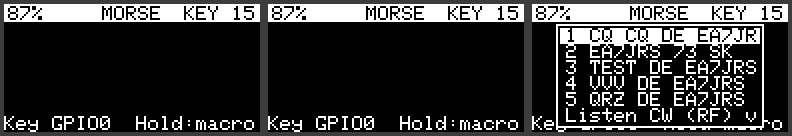

### 21.1 La pantalla MORSE
Muestra el **texto decodificado** de lo que manipulas, escuchas o envías (lo enviado lleva `>` delante), la letra en curso en puntos y rayas y, en la cabecera, el tipo y la velocidad del manipulador (`KEY`, `IA`, `IB` + WPM). Es la única pantalla del modo: 1P no cambia de página.

### 21.2 Submenú (LP)
**1–5** envían la macro correspondiente · **Listen CW (RF)** · **Trainer: listen** · **Trainer: keying** · **CW beacon: ON/OFF** · **Clear text** · **Change mode** · **Back**.

### 21.3 Macros
Cinco mensajes editables en la WebUI (LoRa → CW / Morse), con `{CALL}` sustituido por tu indicativo. Por defecto: «CQ CQ DE {CALL} {CALL} K», «{CALL} 73 SK», «TEST DE {CALL}», «VVV DE {CALL}», «QRZ DE {CALL} K». Se emite una portadora continua del SX1262/SX1268 manipulada todo/nada (A1A) en la frecuencia y potencia del perfil activo; con un receptor en CW/SSB se oye el tono. El botón aborta. Mientras dura, el resto del Tracker está en pausa. La velocidad (5–40 WPM) se fija en la WebUI.

### 21.4 Manipulador en jack de 3,5 mm
En la WebUI define los pines: punta = *Key / dit GPIO*, anillo = *Dah GPIO*, malla = GND (−1 = sin manipulador). Son entradas con pull-up (el contacto va a masa); usa GPIO libres de tu placa.
- **Straight key** (vertical): solo punta; decodificador adaptativo (el WPM configurado debe estar cerca del tuyo).
- **Iambic A / B**: punta = punto, anillo = raya, con memoria de paletas. *Swap paddles* para zurdos.
- *Key the RF carrier*: el manipulador emite la portadora RF en directo. *Sidetone*: tono de 700 Hz en el zumbador (hay que tenerlo activado); suena con el manipulador, las macros (a mano o con el teclado FH-2), el entrenador y el mando remoto, no con la baliza autónoma.
- Al accionar el manipulador con la pantalla MORSE abierta empieza una sesión que termina a los 2,5 s sin actividad o con el botón.

### 21.5 Escucha CW por RF
Submenú → **Listen CW (RF)**. El chip pasa a FSK de banda estrecha (4,8 kHz) en la frecuencia del perfil y se lee el RSSI instantáneo (~1 kHz). Un detector de envolvente con umbral adaptativo y un decodificador adaptativo lo convierten en texto (cabecera `RX <wpm>`). La **primera línea** muestra el **S-meter** (VHF/UHF, IARU: S9 = −93 dBm, 6 dB por punto, S9+10, +20…), el nivel en dBm y el SNR; debajo, las tres últimas líneas de texto y la letra en curso. La última línea muestra el **squelch**: **pulsación corta** = siguiente valor (OFF, −120 … −70 dBm en pasos de 5), **pulsación larga (0,7 s)** = salir y restaurar el modem. Por debajo del squelch no se decodifica ni se pinta nada (histéresis de 3 dB). También se ajusta en el submenú (*CW squelch*) y en la WebUI (LoRa → CW / Morse → *CW RX squelch*).
- Pensado para portadora manipulada (A1A) a ±2 kHz de la frecuencia del perfil. No es un demodulador de audio.
- Necesita ≥ 6 dB entre portadora y ruido; con señal débil o QSB fuerte decodifica mal.
- Durante la escucha no hay recepción APRS ni balizas.

### 21.6 Baliza CW autónoma
WebUI → CW / Morse: **CW beacon every (min)** (0 = off) y **CW beacon text** con `{CALL}`, `{LOC}` (locator de 6 caracteres si hay fix) y `{VBAT}` (voltios). Por defecto `DE {CALL}/B {LOC} V{VBAT}` → `DE EA7JRS/B IM77AJ V4.1`. Con el intervalo > 0, en modo MORSE emite a los 10 s del arranque y luego cada intervalo. Submenú → **CW beacon: ON/OFF** para activarla o pararla. El botón aborta la emisión en curso. La placa no entra en sueño profundo entre balizas.

**Pantalla CW BEACON (5.2.11).** En modo MORSE hay dos pantallas, que se alternan con pulsación corta: **MORSE** (manipulador, escucha y trainer) y **CW BEACON**, dedicada a la baliza como en WSPR y LR-FHSS. Muestra el indicativo, la velocidad (WPM), la potencia, la frecuencia del perfil CW Beacon con el intervalo, el texto de la baliza ya expandido (`{CALL}`, `{LOC}`, `{VBAT}`), el estado (`Beacon OFF`, cuenta atrás `Next TX mm:ss`, `Sent #n` o `Aborted` durante 8 s) y el número de balizas enviadas. Pulsación larga → **Beacon: ON/OFF**, **Send now** (emite ya, sin esperar), **Tune carrier** (portadora de 30 s para medir la frecuencia, capítulo 25), **Change mode** y **Back**. Durante la emisión se ve la pantalla «CW TX» con el texto y la barra de progreso; el botón la aborta. *Sin probar en placa.*

### 21.7 Trainer (método Koch)
No emiten RF. En la WebUI se ajustan el **nivel Koch** (2–41; orden K M R S U A P T L O W I . N J E F 0 Y , V G 5 / Q 9 Z H 3 8 B ? 4 2 7 C 1 D 6 X) y la **velocidad Farnsworth** de los espacios (0 = sin Farnsworth); la velocidad de los caracteres es el WPM general.
- **Trainer: listen** (zumbador activo): suena un grupo de 5 caracteres, la pantalla muestra `?????`; a los 1,5 s se revela el grupo y a los 3 s empieza el siguiente. Lo identificas de oído y lo comparas con lo revelado; no cuenta aciertos. El botón sale y muestra cuántos grupos has hecho.
- **Trainer: keying** (GPIO de manipulador definido): se muestra un carácter grande y su código; lo tecleas, el decodificador lo lee y se indica OK o lo que tecleaste. Arriba a la derecha, aciertos/intentos. El botón sale.

### 21.8 Límites
Solo SX1262/SX1268 emiten (sin ellos se puede decodificar y oír el sidetone). Temporización PARIS, keyer y decodificador comprobados en PC; **probado con manipulador real (vertical e iambico)**.

## 22. Modo WSPR beacon

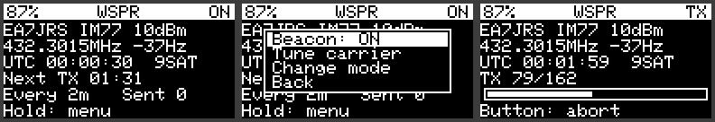

Baliza WSPR autónoma sincronizada por GPS. Se elige en **SELECT MODE → WSPR beacon** (solo SX1262/SX1268) y, como MORSE, no se guarda. Su única pantalla es **WSPR**. Ficha técnica en `WSPR.md`.

### 22.1 Qué emite
Mensaje WSPR **tipo 1**: tu indicativo (sin SSID; máximo 6 caracteres, sin prefijos ni sufijos como `/P`), **locator de 4 caracteres** y potencia, codificado a 162 símbolos 4-FSK a 1,4648 baudios con 1,4648 Hz entre tonos. Dura 110,6 s y empieza 1 s después del minuto par. La hora la da el GPS (sin hora válida no se emite). El locator sale de la posición GPS en cada emisión (baliza «tracker»), o es el fijo que pongas en la WebUI.

### 22.2 Configuración (WebUI → CW / Morse → WSPR beacon)
| Campo | Significado |
|---|---|
| Fixed centre (Hz) | **Fija** e inmodificable: dial 432,300 MHz USB + 1500 Hz = `432301500` |
| Frequency offset (Hz) | Corrección medida del oscilador (ver 22.4) |
| Power | 0, 3, 7, 10, 13, 17 o 20 dBm: es la potencia del mensaje y de la radio (por defecto 10 dBm) |
| Transmit | Una emisión cada 2, 4, 6, 10, 12, 20, 30 o 60 min; el desplazamiento dentro del ciclo depende del indicativo |
| Fixed locator | 4 caracteres; vacío = el del GPS |
| Fine tone spacing | Cada símbolo en dos tramos (dos pasos vecinos del PLL de 0,954 Hz, un solo cambio a mitad del símbolo) para aproximar la separación de 1,4648 Hz. Activado por defecto |
| Screen off while transmitting | Apaga la pantalla durante la emisión (menos consumo y calor junto al TCXO). Desactivado por defecto |
| Drift compensation (0,1 Hz/min) | Rampa de frecuencia durante la emisión, centrada en la mitad (no cambia el centro calibrado). Positivo = la frecuencia sube. Para anular un drift de −4 Hz/min de WSJT-X: `+40`. 0 = desactivada (por defecto). Ver `WSPR_CALIBRACION.md` |
| Per-power calibration table | Si se activa, el offset y la compensación de deriva se toman de una tabla con una fila por potencia (0, 3, 7, 10, 13, 17 y 20 dBm) y los dos campos generales dejan de usarse. Cada fila se calibra una vez con esa potencia. Sin tabla guardada, las filas parten de los valores generales |

### 22.3 La pantalla
Indicativo, locator y potencia; frecuencia y desplazamiento; hora UTC y satélites; **cuenta atrás** hasta la próxima emisión (o `TX n/162` con barra de progreso); intervalo y emisiones enviadas. **LP** abre el submenú: **Beacon: ON/OFF**, **Tune carrier**, **Change mode**, **Back**. El botón aborta una emisión (o un Tune) y deja la baliza en OFF. Mientras emite, el resto del Tracker está en pausa.

### 22.4 Calibración de frecuencia (imprescindible)
WSPR solo decodifica si la señal queda a ±100 Hz del centro (±0,23 ppm a 432 MHz). El TCXO del SX1262 tiene una tolerancia típica de ±1 a ±2 ppm (cientos de Hz) y deriva con la temperatura, así que **hay que calibrar**:
1. Submenú → **Tune carrier** (30 s de portadora sin modular en la frecuencia central).
2. Mide la frecuencia con un SDR y calcula `desplazamiento = nominal − medida` en Hz.
3. Escríbelo en *Frequency offset* y repite con la placa a temperatura de trabajo.
Aun así, la deriva térmica puede sacar la señal de la ventana: un ΔF grande en los spots de wsprnet.org lo indica.

### 22.5 Hardware y seguridad
- La portadora está activa el 92 % del tiempo (110,6 s de cada 120 s): empieza con poca potencia y vigila la temperatura del SX1262.
- Los armónicos del SX1262 requieren un **filtro paso bajo de 70 cm** antes de la antena.
- Solo en bandas de aficionado y con tu licencia; las normas nacionales prevalecen.

### 22.6 Límites
Solo mensajes tipo 1 (sin prefijos/sufijos ni locator de 6 caracteres). Precisión de hora ≈ ±0,3 s (suficiente para WSPR). Sin sueño profundo entre emisiones. El codificador está verificado en PC contra una implementación de referencia; **la emisión real, el cambio de tono en transmisión y la deriva de frecuencia no se han probado en hardware**.

---

## 23. WebUI reorganizada (5.2.11)

El menú **CONFIGURATION** de la WebUI queda: Beaconing, Station, **GPS**, **Transmission mode**, Connectivity, Hardware, Telemetry, Administration y About.

### 23.1 Beaconing
El bloque «Beacon» pasa a llamarse **Beacon User Profile** (perfil de usuario por indicativo: SSID, símbolo, comentario, SmartBeacon y perfil LoRa).

### 23.2 GPS
Se aplica al arrancar (guardar reinicia el equipo). El tipo de módulo se detecta solo.

| Ajuste | u-blox M10 | L76K |
|---|---|---|
| Constelaciones GPS, Galileo, BeiDou, GLONASS, QZSS, SBAS | Sí (SBAS y QZSS necesitan GPS; BeiDou y GLONASS no a la vez; al menos una de GPS/Galileo/BeiDou/GLONASS) | Solo GPS, BeiDou y GLONASS (QZSS siempre activo, sin Galileo) |
| Opciones SBAS (correcciones diferenciales, ranging, integridad) | Sí | No |
| AssistNow Autonomous (A-GPS sin conexión) | Sí | No |
| Modelo dinámico, elevación mínima, static hold | Sí | No |
| Tasa de actualización | 0,1–2 Hz | 1, 2, 4 o 5 Hz (máximo del módulo) |
| Salida PPS (frecuencia, anchura, flanco, retardos de cable y de usuario) | Sí | No |

En otras placas la sección indica «Not configurable». Los comandos del L76K (CASIC `$PCAS`) proceden de la documentación del fabricante y **no están verificados en hardware**. *Disable GPS* sigue en Station. Las constelaciones ya no se guardan en `/gps_gnss.dat`, sino en la configuración.

**Funciones propias del Quectel L76K (CASIC, chip AT6558R)** — se activan solas cuando el módulo habla NMEA pero no responde a UBX:

- **Constelaciones** (`$PCAS04`): GPS, BeiDou y GLONASS en cualquier combinación (también BeiDou + GLONASS, que el M10 no admite). Tiene máscara propia (`cnMask`), por lo que cambiar de módulo no pisa la del M10. QZSS siempre activo; el L76K no soporta Galileo ni SBAS.
- **Tasa** (`$PCAS02`): 1, 2, 4 o 5 Hz. Por encima de 1 Hz el puerto serie sube solo de 9600 a 115200 baudios (`$PCAS01`) y solo se conserva si llegan tramas válidas; si no, vuelve a la velocidad anterior.
- **Salida NMEA reducida** (`$PCAS03`, casilla *Reduced NMEA output*, activada por defecto): solo GGA, RMC, GSV y estado de antena; la GSV baja de frecuencia por encima de 1 Hz. Menos tráfico y menos carga de CPU.
- **Estado de la antena** (`$GPTXT … ANTENNA OK/OPEN/SHORT`): se avisa en el log solo cuando cambia y se muestra en la sección GPS de la WebUI (sin antena, o antena en cortocircuito).
- **Modo eco**: si la alimentación del receptor se corta en reposo, al despertarlo se detecta la velocidad y se vuelve a configurar.
- Satélites a la vista: se cuentan también las frases `BDGSV` de BeiDou.
- No hay equivalentes verificados de modelo dinámico, static hold, AssistNow ni configuración de PPS (el pulso es fijo, de 100 ms, flanco de subida): esos ajustes quedan atenuados.
- En la pantalla GPS del equipo, Galileo, SBAS y QZSS avisan de que no se pueden cambiar en el L76K.

La prueba en PC cubre los comandos con los ejemplos del fabricante (suma de verificación) y la lectura de `GPTXT` y `BDGSV` con la librería TinyGPS++. Falta la prueba en una placa real.

### 23.3 Transmission mode
«LoRa» pasa a llamarse **Transmission mode**, con un grupo por modo:
- **APRS LoRa:** 4 perfiles regionales (EU/WORLD, Polonia, UK, US) más el perfil nautico AIS (frecuencia editable; SF 9 y CR 4/5 fijos). Región IARU, canal, frecuencia, SF, CR, BW y potencia. La opción **Listen before transmitting** (antes CAD): ver 23.4.
- **APRS FSK:** al ser un modo analógico cada perfil (1 y 2) tiene su **propia** región IARU, canal, frecuencia y potencia, más velocidad, desviación y ancho de recepción.
- **CW Beacon:** dos perfiles de radio, cada uno con región IARU, canal, frecuencia y potencia: **1) CW Beacon** (baliza autónoma) y **2) Telegrafía** (manipulador, mensajes, trainer y escucha CW). El equipo cambia de uno a otro automáticamente.
- **WSPR Beacon:** la frecuencia es **fija** (432 301 500 Hz) y no se puede modificar; se ajustan el offset, la potencia, el intervalo, el locator y las opciones de calibración.
- **LR-FHSS Beacon (experimental):** grupo **reservado**. El código transmisor está en el firmware pero desactivado hasta que se autorice su uso (ver `LRFHSS_BALIZA.md`).

### 23.4 Listen before transmitting (CAD)
- **LoRa:** CAD; se espera a que el canal quede libre durante 2 ranuras (DIFS) y luego un backoff aleatorio. Si el canal está ocupado la ventana se duplica (4, 8, 16, 32 ranuras).
- **FSK:** detección de portadora por RSSI (SX1262/SX1268); el canal está ocupado por encima de **FSK busy above** (−95 dBm por defecto).
- **Max wait for a free channel:** 1–60 s (10 por defecto); pasado el tiempo se transmite igualmente. Un error del chip cuenta como canal libre.

## 24. Campanas APRS en zumbador pasivo (5.2.11)

Con un zumbador pasivo (por ejemplo **KY-006**) el Tracker puede reproducir melodías de «campana APRS» inspiradas en la tabla *List of APRS Bell Rings* del manual APRS del Yaesu FTM-400DR: *ding* = nota aguda, *dong* = nota grave. Se activa en la WebUI → Notification → **APRS bell rings** (por defecto activado; requiere tener el buzzer activo). Si se desactiva, vuelven los pitidos de siempre.

| Evento | Melodía | Dónde se dispara |
|---|---|---|
| Boletín (BLN/NWS) recibido | ding ding ding ding ding dong | mensaje de otra estación con destino BLN o NWS |
| Mensaje para mi indicativo | ding ding ding dong | mensaje recibido dirigido a mí |
| REJ recibido | ding (más grave) | respuesta `rej` a un mensaje mío |
| ACK recibido | ding | respuesta `ack` a un mensaje mío |
| Baliza recibida | ding dong | estación escuchada |
| Mensaje de otra estación | ding | mensaje con otro destinatario |
| Mensaje duplicado | ding ding (corcheas) | mismo mensaje en los últimos 15 s |
| Baliza duplicada | ding (corchea) | misma baliza en los últimos 15 s |
| Baliza o mensaje enviado | ding | transmisión propia |

- Si dos melodías coinciden suena la de mayor prioridad (orden de la tabla); una igual o menos importante no pisa a la que está sonando.
- La reproducción **no bloquea** el programa: la pantalla y la radio siguen funcionando mientras suena.
- Los duplicados solo suenan si «station beep» está activado.
- **Las alturas son aproximadas**: el manual de Yaesu da solo notación musical, no frecuencias. Se pueden afinar en `include/bell_rings.h` (tabla `BELL_TABLE`).
- Conexión del KY-006: S → pin de tono del buzzer, centro → pin Vcc del buzzer (el programa lo activa solo mientras suena), − → GND. Los pines se configuran en la sección Notification. Si el módulo lleva un transistor y necesita 5 V, usa el pin de alimentación adecuado de tu placa.
- **Sin probar en hardware** (solo el reproductor de notas, en PC).

## 25. Calibración de frecuencia global (5.2.11)

El oscilador del SX1262 (TCXO o cristal) se equivoca una cantidad **proporcional a la frecuencia** (ppm), igual en todos los modos. Un solo ajuste lo corrige: WebUI → Transmission mode → **Frequency calibration** → **Correction (ppm)** (−50 a +50, **tres decimales**; ppm positivo = la frecuencia emitida sube). Se aplica a la **emisión y a la recepción** de APRS LoRa, APRS FSK, CW/Morse (incluida la escucha) y LR-FHSS (reservado).

**Cómo calibrar**
1. Pon la corrección en 0 y guarda. Enciende el tracker y espera 10 minutos con la caja cerrada.
2. Emite una portadora: **Tune carrier** en el submenú de la pantalla **CW BEACON** (frecuencia del perfil CW Beacon + corrección actual) o de **WSPR**. Dura 30 s o hasta pulsar el botón.
3. Mide la frecuencia con un SDR con referencia fiable (GPSDO), como en `docs/WSPR_CALIBRACION.md`. Error = medida − esperada (Hz).
4. En la WebUI escribe en «Measured at (MHz)» la frecuencia de la medida y en «Error (Hz)» el error, y pulsa **Apply to ppm**: suma `−error / frecuencia` (Hz ÷ MHz = ppm). Guarda. Repite tres veces y usa la media.
5. Verifica con otra portadora: debe quedar en menos de unos 20 Hz a 433 MHz.

**WSPR.** Mantiene su propio offset en hercios (precisión de 1 Hz). Si activas «Use the global frequency correction (ppm)», WSPR usa los ppm globales en lugar de ese offset (resolución de 0,001 ppm ≈ 0,4 Hz a 432 MHz; en WSPR se redondea a hercios enteros); la tabla por potencia, si está activada, tiene prioridad. Para WSPR a ±2 Hz es mejor seguir con el offset en hercios.

**Límites.** El tracker no puede medir su propio error: hace falta un SDR. La deriva térmica no se corrige. Desde 5.2.12 la frecuencia se programa en el SX1262/SX1268 con la palabra exacta del PLL (paso de 0,954 Hz), así que la corrección fina en ppm se aplica de verdad; antes pasaba por un `float` de ≈ 30 Hz de resolución y las correcciones pequeñas se perdían. En SX127x el paso es de ≈ 61 Hz. Con TCXO el efecto es pequeño (decenas a cientos de hercios); en placas con cristal es de kilohercios. *Sin probar en placa.*

## 26. DAPNET: receptor de buscapersonas POCSAG (5.2.11)

Modo **solo recepción** para la red de radioaficionados DAPNET (*Decentralized Amateur Paging Network*, hampager.de). El tracker **nunca emite** en este modo: no hay balizas APRS, SOS ni mensajes. Se elige en el arranque: **SELECT MODE → DAPNET pager** (no se guarda como modo predeterminado, como MORSE y WSPR).

**Cómo funciona.** El SX1262 se configura en FSK a 1200 baudios (también 512 y 2400), en recepción continua y sin sincronismo hardware, y entrega el flujo de bits en bruto. El decodificador POCSAG (`include/pocsag.h`) busca en software el preámbulo y la palabra de sincronismo `0x7CD215D8`, aplica la corrección BCH(31,21) de hasta 2 bits por palabra, detecta la polaridad invertida y extrae las direcciones (RIC = dirección × 8 + trama), el tipo de función y el texto (alfanumérico de 7 bits o numérico BCD). Es el mismo método que ya usa APRS FSK 9600.

**Pantalla DAPNET** (cabecera: `RX` escuchando, `SYNC` al detectar una transmisión, `MSG` durante 6 s tras un mensaje nuevo):
- Fila 0: frecuencia y velocidad. Sin mensajes: estado del filtro (RIC propios, modo monitor), «Listening…» y la última hora recibida (`Time … (clock)` si ajustó el reloj).
- Con mensajes: `*1/3 1234560 F3 12s` = mensaje 1 de 3, `*` propio (`#` ajeno), RIC, función, antigüedad; debajo hasta 3 líneas de texto (63 caracteres visibles).
- Última fila: RSSI, lotes recibidos (B), mensajes (M) y `T` si ha llegado una hora.
- Submenú (pulsación larga): **Older message**, **Newer message**, **Clear list**, **Monitor all: ON/OFF**, **Change mode**, **Back**. Se guardan los últimos 10 mensajes (solo en RAM).

**Ajustes (WebUI → Transmission mode → DAPNET Pager)**
- *Frequency*: 439,9875 MHz por defecto (frecuencia habitual de DAPNET en Europa, también en España). El SX1262 cubre 150–960 MHz: la banda de 2 m (144,8625 MHz) no es posible.
- *Baud rate*: 1200 (DAPNET); *Deviation*: ±4,5 kHz; *Receiver bandwidth*: 14,6 kHz (con margen para el error del oscilador; usa la calibración ppm del capítulo 25).
- *My RICs*: hasta 8 direcciones (0–2097151) separadas por comas. Sin RIC propios solo se ven los mensajes de los RIC del sistema (RIC 8 = identificación del transmisor, y los RIC de hora).
- *Monitor mode*: lista todos los mensajes oídos, no solo los propios.
- *Time sync*: ajusta el reloj con los mensajes de hora **UTC** de DAPNET (Skyper 2504, AlphaPOC 216, Swissphone 200, Birdy 2000), solo si el GPS no tiene hora válida.
- *Character set*: ASCII o ISO 646 alemán (DIN 66003: `[ \ ] { | } ~` → Ä Ö Ü ä ö ü ß).

**Avisos.** Los mensajes **propios** suenan con la melodía «mensaje para mí» (capítulo 24) y encienden la pantalla.

**Pendiente de confirmar** (la documentación de DAPNET no se pudo leer completa; si me pasas el documento lo ajusto): desviación exacta de los transmisores, juego de caracteres por defecto, correspondencia RIC ↔ indicativo y formato exacto de los mensajes de hora (se aceptan `HHMMSS DDMMAA`, `AAMMDDhhmmss` y 14 dígitos). **No se ha probado en el aire**: la lógica POCSAG está verificada en PC con un codificador sintético (sincronismo, corrección de errores, polaridad, varios mensajes, ruido), pero no la recepción real con el SX1262.

## 27. GFSK / GMSK por perfil FSK y cabecera de la WebUI (5.2.12)

**Filtro gaussiano del transmisor FSK.** Cada perfil FSK tiene ahora el selector **Modulation / Gaussian filter (TX)** (WebUI → Transmission mode → perfiles FSK): *GFSK BT 0,5* (por defecto, el de G3RUH, igual que hasta ahora), *GMSK BT 0,3*, *GFSK BT 0,7*, *GFSK BT 1,0* o *FSK sin filtro*. Se aplica al emisor del SX126x (`setDataShaping`) al configurar el módem FSK y al volver al perfil. **El receptor no depende de este ajuste.** Para GMSK propiamente dicho (modulación MSK con filtro gaussiano) pon la **desviación = velocidad / 4** (2,4 kHz a 9,6 kbps); con la desviación estándar de G3RUH (3 kHz) la señal es GFSK. Si cambias el filtro, el otro extremo debe usar la misma modulación y un ancho de banda de recepción suficiente. DAPNET (solo recepción) no usa filtro. *Sin probar en el aire ni en el analizador: se recomienda comprobar el espectro con un SDR.*

**WebUI.** El bloque del receptor **Quectel L76K** (salida NMEA reducida, estado de antena) pasa al **final de la sección GPS**, tras Navigation y PPS, de modo que los grupos del u-blox M10 quedan seguidos; sigue oculto salvo que se detecte un L76K. La cabecera muestra **APRS LoRa+** y debajo `Tracker <versión>`; el apartado **About** conserva toda la información original (incluida la atribución a CA2RXU) y añade una línea entre la información de compilación y la de CA2RXU: `APRS LoRa+ · © 2026 Manuel - EA7JRS`. La versión de la cabecera se lee del firmware (`/version`), así que no puede quedar desfasada.

## 28. Compatibilidad con las placas del proyecto (5.2.12)

Todo lo nuevo de 5.2.11 y 5.2.12 es parte del firmware común y se compila para **todas** las placas de `variants/`; lo que depende del chip o de la placa se desactiva solo, sin cambiar nada en las demás.

| Función | SX1262 / SX1268 | SX1276 / SX1278 | LLCC68 (E220) |
|---|---|---|---|
| APRS LoRa, calibración ppm, campanas APRS, mensajería | sí | sí | sí |
| APRS FSK 9600 (G3RUH) | sí | sí | no (solo LoRa) |
| GFSK / GMSK (filtro gaussiano) | BT 0,3 · 0,5 · 0,7 · 1,0 · sin filtro | BT 0,3 · 0,5 · 1,0 · sin filtro (BT 0,7 usa 0,5) | no |
| MORSE / CW y WSPR (portadora) | sí | no | no |
| DAPNET (recepción POCSAG) | sí | no | no |
| LR-FHSS (reservado, desactivado) | sí | no | no |

- **El selector de modo** (SELECT MODE) solo ofrece los modos que el chip de la placa puede hacer: en una T-Beam con SX1278 verás *APRS LoRa* y *APRS FSK 9600*; en una con SX1262/SX1268 todos, y *LR-FHSS* solo si se activa en la WebUI. La WebUI muestra todos los grupos en todas las placas, pero los de CW, WSPR, DAPNET y LR-FHSS no hacen nada en chips que no los soportan (lo indican sus textos).
- **Placas sin botón** (ESP32-C3 SuperMini DIY y heltec_ht-ct62): no hay selector de arranque; arrancan siempre en el último modo APRS guardado.
- **Placas sin pantalla APRS** (Heltec Wireless Stick Lite V3 TNC y las que definen `NO_APRS_PAGES`): no tienen las pantallas ni la mensajería en pantalla; el resto de funciones de radio y la WebUI funcionan igual.
- **Pantallas distintas:** las pantallas nuevas (CW BEACON, DAPNET, lista de mensajes) se dibujan en el lienzo lógico de 128×64 que ya usa el resto, así que sirven igual en OLED 128×64, en el Heltec Wireless Tracker (160×80) y en el T-Deck (ampliadas ×2).
- **Zumbador:** las campanas APRS suenan en las placas con zumbador pasivo configurado; en las demás no hacen nada.
- **Memoria:** DAPNET añade unos 3 KB de RAM estática (decodificador 220 B + 10 mensajes) y el código nuevo unas decenas de KB de flash; todas las placas usan `huge_app.csv`. Al compilar, comprueba el uso de flash de las placas con menos memoria.
- **Sin compilar ni probar en placa:** he revisado el código con `-Wall` en PC (SX1262, SX1278, SX1276 y LLCC68) y con pruebas unitarias del decodificador POCSAG, pero no con PlatformIO ni en ninguna placa real.

## 29. FT8 / FT4 / FST4W beacon y LR-FHSS activable (5.3.0)

**FT8 beacon / FT4 beacon / FST4W beacon.** Se eligen en SELECT MODE (solo SX1262/SX1268) y, como WSPR, no se guardan. Solo transmiten; su única pantalla es la de la baliza (cuenta atrás, hora UTC, satélites). Mensaje «CQ INDICATIVO LOCATOR» o texto libre de hasta 35 caracteres. La ranura sale de la hora GPS (FT8 15 s, FT4 7,5 s) y la emisión dura 12,64 s (FT8) o 5,04 s (FT4). La frecuencia es la de **dial**: el tono 0 sale 1500 Hz por encima. FT8 trae 432,174 MHz (lista de WSJT-X); **FT4 no tiene frecuencia por defecto y no emite hasta que se escribe una**. Elige siempre un canal que permita el plan IARU de tu región y la norma nacional: la WebUI avisa si el segmento es de balizas, repetidores o voz digital. La pantalla no se redibuja durante la emisión; el botón la aborta. **FST4W** envía el mensaje de 50 bits de WSPR (indicativo, locator de 4 caracteres y potencia; la potencia se redondea a 0, 3, 7, 10, 13, 17 o 20 dBm) en periodos de 120 s (emisión de 109 s) o 300 s (287 s, experimental), empezando 1 s después del comienzo del periodo. Tampoco tiene frecuencia por defecto. Configuración: WebUI → tarjeta «FT8 / FT4 / FST4W Beacon». Sin pruebas en placa.

**LR-FHSS beacon.** Se activa con el interruptor de su tarjeta en la WebUI (apagado por defecto); entonces aparece en SELECT MODE. Ver `LRFHSS_BALIZA.md`. Experimental; el titular responde de la autorización que exijan las normas nacionales.

Estudio de cobertura de todos los modos: `ESTUDIO_COBERTURA.pdf`. D-Star/DPRS: previsto para 5.4.

## 30. Instalar y actualizar el firmware (5.3.1)

**Por USB (todas las placas).** Abre la página del proyecto (`https://ea7jrs.github.io/APRS-LoRa-Plus/`) en Chrome o Edge, conecta la placa, pulsa *Detectar placa* (lee placa y versión instalada) y después *Instalar*. La configuración se conserva. Si la placa no aparece, mantén BOOT al conectarla.

**Desde la WebUI (solo placas con dos copias de firmware: T-Beam S3 Supreme y T-Beam 1W).** Administración > *Firmware update*: arriba verás placa, versión y si admite actualización web.
- *Archivo*: elige el `.bin` de tu placa y pulsa *Upload and install*. Si es de otra placa, se rechaza.
- *Por internet o Bluetooth*: **lo hace la app Android APRS LoRa+** (pestaña *Firmware*): busca la versión publicada, la descarga con el internet del móvil, comprueba tamaño y SHA-256 y la envía a la placa por Bluetooth. La placa no descarga nada por sí misma (ya no lleva cliente HTTPS: libera unos KB de flash) y no hay actualización automática al arrancar.

Las placas ESP32 clásicas, ESP32-C3, Heltec S3 y T3S3 no tienen sitio para dos copias: se actualizan por USB. Si una actualización dejase la placa sin arrancar, reinstala por USB.

## 31. Vigilancia de grupo y emergencia remota (5.3.2)

Solo en los modos **APRS LoRa** y **APRS FSK 9600**. Ambas funciones están apagadas por defecto (WebUI → Station → *Group watch & remote emergency*).

**Vigilancia de grupo (estilo ARTS del FT-270E).** Escribe hasta 5 indicativos (sin SSID vale cualquier SSID). La página **GROUP** muestra cada estación con *IN* (oída hace menos de *OUT after* minutos y, si lo has puesto, a menos de *Max km*) u *OUT*, y su distancia o el tiempo desde que se oyó. Al entrar o salir de alcance aparece «IN RNG / OUT RNG indicativo» y suena el zumbador. Tras el arranque se espera ese tiempo antes de dar a nadie por perdido.
- **Sondeo opcional:** con *Poll* ≥ 60 s se envía un mensaje «ping» a quien no se ha oído en ese tiempo; un tracker con este firmware responde «pong» y cuenta como oído. Usa intervalos largos (el canal es compartido y en FSK no hay escucha previa).

**Manejo de la página GROUP (estilo Group Monitor «GM» del FT5DE).** Pulsación larga abre el submenú:
- **Browse**: un cursor recorre los miembros (1P siguiente, 2P salir). Abajo se ve el rumbo, el punto cardinal y la distancia del marcado. Pulsación larga: **GO TO** (abre la brújula apuntando a esa estación), **Quick msg** (respuesta rápida solo a ese miembro) o **Ping**.
- **Radar**: vista tipo APL con tu posición en el centro, norte arriba y cada miembro numerado según su rumbo y distancia (círculo relleno = IN, hueco = OUT o fuera de escala). La escala es automática (se ve «A») o fija de 1 a 500 km: 1P la cambia; *Auto scale* la restablece.
- **Quick msg: all** envía la respuesta rápida (QSL, 73, TNX…) a todos los miembros que están IN, como «SEND to ALL» de Yaesu; **Ping all** pregunta a todos.
- Los miembros aparecen en el radar y en GO TO cuando se ha recibido su posición. Probado en placa.

**Emergencia remota (estilo EAI).** Indica quién puede activarla y un código de 4–12 caracteres. Desde un cliente APRS, enviando un mensaje al tracker: `EAI <código>` inicia la baliza SOS (la misma de la emergencia local, cada 30 s, con posición GPS) durante *Duration* minutos, con alarma sonora y sin cuenta atrás; `EAI STOP <código>` la termina. El tracker contesta «EAI ON n min» o «EAI OFF». Un remitente no autorizado o un código erróneo se ignoran sin respuesta. El gesto del botón la cancela.
- El código viaja sin cifrar: evita errores, no es seguridad. Cada usuario debe asegurarse de que el control remoto está permitido por su normativa.
- Probado en placa.

## 32. KISS por WiFi (5.3.2)

La placa puede ser un **TNC KISS por WiFi** para programas como **APRSdroid** (probado en Android: en *Connection protocol* elige la opción de TNC por TCP/IP), Xastir o YAAC. Solo en **APRS LoRa** y **APRS FSK 9600**, y en placas **ESP32-S3 / C3** (T-Beam S3 Supreme, etc.); las ESP32 clásicas y la T-Deck no lo incluyen.

1. En la WebUI, Administración → *Firmware update*, escribe la **WiFi** (SSID y contraseña) de tu casa o del **punto de acceso del móvil**; es la que usan el KISS por WiFi, el CAT, el rotor y la descarga de satélites.
2. Connectivity → **KISS over WiFi**: activa el interruptor (apagado por defecto), elige el **puerto TCP** (8001 por defecto) y, si quieres, un **puerto UDP** (0 = sin UDP). *Allowed addresses* limita quién puede conectar: direcciones separadas por comas, o un prefijo acabado en punto (`192.168.1.` = toda esa red); vacío = cualquiera de la red.
3. Guarda y reinicia. Al unirse a la WiFi la pantalla muestra durante unos segundos la **IP** y los puertos; también responde como `aprs-lora-plus.local`. En APRSDroid escribe esa IP y el puerto.

- En FSK las tramas que envía el cliente deben ser AX.25 válidas y de un tamaño que quepa en el paquete FSK (si no, se descartan y queda anotado en el registro); lo que se oye por FSK se entrega igual que por LoRa.
- Hasta 3 clientes TCP a la vez. Reciben las tramas oídas por radio y las balizas que emite el propio tracker; lo que envían se transmite por LoRa (los comandos de ajuste KISS se aceptan y se ignoran). UDP: cada datagrama lleva tramas KISS completas y la placa responde a la última dirección que le escribió.
- **Consumo:** la WiFi queda encendida y la placa no entra en sueño profundo.
- **Seguridad:** KISS no tiene contraseña; cualquiera permitido puede transmitir con tu indicativo. Úsalo en redes de confianza y con la lista de direcciones.
- Con el punto de acceso del móvil, la IP puede cambiar entre sesiones: mira la pantalla o usa `aprs-lora-plus.local` si tu aplicación lo resuelve. Probado con APRSdroid en Android por TCP en **LoRa y en FSK**; UDP sin probar. El nombre `.local` (mDNS) lo resuelven bien Windows, macOS y Linux, pero **muchas aplicaciones de Android no**: allí usa la IP que muestra la vista LINK de SYSTEM. El nombre de equipo en la red es `aprs-lora-plus` (se aplica al reiniciar).

## 33. CAT por WiFi (Hamlib) (5.3.3)

La placa puede hablar el protocolo **NET rigctl** de Hamlib (el de `rigctld`), así que programas como GPredict, `rigctl` o scripts de Hamlib la ven como una radio: leen la **frecuencia**, el **modo** (APRS LoRa o APRS FSK 9600), el **RSSI** y la **potencia**. **No es una radio de audio**: WSJT-X y fldigi no pueden decodificar ni modular a través de ella; solo pueden seguir la frecuencia o, con *PTT = baliza*, hacer que el tracker emita su baliza APRS. Solo en APRS LoRa y APRS FSK, en placas ESP32-S3 / C3.

1. Pon la WiFi en Administración → *Firmware update* (la misma que usa KISS por WiFi); el apartado se llama así por historia.
2. Connectivity → **CAT (Hamlib) over WiFi**: activa el interruptor (apagado por defecto), elige el **puerto TCP** (4532), la **ventana de sintonía** en kHz (0 = el programa no puede cambiar la frecuencia) y, si quieres, las **direcciones permitidas**. *PTT sends an APRS beacon* hace que una orden PTT de Hamlib emita una baliza (apagado por defecto).
3. Guarda y reinicia (o usa **WiFi CAT: ON/OFF** en el submenú de SYSTEM, que se aplica al momento). KISS y CAT comparten el mismo enlace WiFi y pueden estar activos a la vez.
4. Desde el ordenador: `rigctl -m 2 -r aprs-lora-plus.local:4532 f` (modelo 2 = *NET rigctl*).

- Hasta 2 clientes. Sin contraseña: usa redes de confianza y la lista de direcciones.
- **Por USB:** el mismo protocolo por el puerto serie de la placa (115200 baudios). Activa *CAT over the USB serial port* en Connectivity > CAT (apagado por defecto; aplica al reiniciar). Con él activo, el log de ese puerto solo muestra errores. Hamlib no trae modelo serie para este protocolo: usa el backend de `tools/hamlib_backend` (modelo «APRS LoRa+ tracker (USB)», DTR y RTS apagados para no reiniciar la placa) o habla con el puerto directamente. No funciona con la placa en sueño profundo.
- Un cambio de frecuencia pedido por CAT solo vive en RAM: no se guarda y se descarta al cambiar de perfil. El perfil AIS tiene la frecuencia fija.
- El modo no cambia en caliente (se elige al arrancar).
- Protocolo completo para quien quiera hacer su propio cliente o un *backend* de Hamlib: `docs/CAT_HAMLIB.md`. Probado en PC con `rigctl` 4.6.5; sin probar en placa.

## 34. Control por Bluetooth LE, CW por RF y región IARU automática (5.3.4)

- **Control por BLE para la app Android** (APRS LoRa+): segundo servicio BLE junto al KISS (que no cambia). Estado, sensores, GNSS, DAPNET, NMEA, cambio de modo y de perfil, baliza, mensajes, texto CW y manipulador remoto. **Exige emparejar con PIN** (WebUI → Bluetooth → *Control PIN*, por defecto 123456: cámbialo; al cambiarlo se olvidan los móviles emparejados). Detalle: `docs/BLE_CONTROL.md`.
- **CW por RF, escucha:** la primera línea muestra S-meter (S9 = −93 dBm), dBm y SNR; **squelch** ajustable (OFF, −120 a −70 dBm). En la escucha, pulsación corta = siguiente squelch y larga (0,7 s) = salir. El zumbador suena con macros, FH-2, manipulador, entrenador y mando remoto.
- **Región IARU automática:** deduce la región 1/2/3 del GPS y ajusta región, canal y frecuencia de los perfiles LoRa, FSK, FT8 / FT4 / FST4W y CW. Apagada por defecto (WebUI → Transmission mode → *IARU region (auto)*); al arrancar, bajo petición o en marcha, con confirmación *Apply / Keep current* o directa.
- **BLE KISS:** el tracker vuelve a anunciar su nombre y guarda hasta 4 tramas del móvil en cola.
- Sin probar en placa.

## 35. Modo SAT, rotor, app Android y menos flash (5.3.5)

- **Modo SAT** (*Satellites 70cm*, SELECT MODE o BLE): lista de satélites (70 cm, LoRa / LR-FHSS / TinyGS e Inmarsat), azimut, elevación, distancia, próximo paso y Doppler. Recepción con Doppler (CW, FSK / GMSK, LoRa), emisión con precompensación (apagada por defecto, solo a petición y con indicativo real) y secuenciador de preamplificador / PA / PTT. El archivo de satélites (`sats.txt`) lo envía la **app Android** por BLE; el tracker ya no lo descarga. Detalle: `docs/SAT_MODE.md`.
- **Rotor:** cliente `rotctld` (TCP), GS-232 por Bluetooth SPP y evento BLE para la app. Sigue un satélite, la estación de GO TO, un objetivo fijo (hasta 8), **la última estación APRS oída con posición** (LoRa o FSK, con filtro de indicativos y estimación por velocidad y rumbo) o **la última baliza CW con locator**. Acimut y elevación se calculan desde el GPS del tracker. WebUI → *Antenna rotor*. El servidor `rotctld` del tracker atiende a GPredict.
- **App Android:** controla todas las funciones por BLE y muestra todos los datos. El **firmware se actualiza desde la app** (internet del móvil y BLE, placas con segunda ranura): el tracker ya no lleva cliente HTTPS ni actualización por WiFi. La WebUI conserva la subida de un archivo `.bin`. Escucha CW (`cwrx`), A-GPS para el u-blox M10 y rotor desde la app.
- **GPS u-blox M10:** el puerto del receptor sube a 115200 baudios al arrancar (vuelve a 9600 si no llegan frases válidas).
- **LED verde de recepción** activo de fábrica para balizas y CW (solo si el pin está asignado; en la Supreme, IO21).
- **Pantalla de bienvenida** con el nuevo logo (pin con L+ y tres ondas).
- **Menos flash:** la configuración se lee y se escribe con una tabla de campos y la WebUI es más ligera (Bootstrap recortado, ayudas más cortas). La T-Beam Supreme pasa del 91,1 % al 85,2 % de su partición de aplicación.
- **Instalador web** con lanzadores de Tracker, Rotor y Gateway (`#rotor`, `#gateway`), todos con la misma versión.
- Sin probar en placa.

## 36. T-TWR Plus, satélites por grupos, AIS y tiempo de internet (5.4.0)

- **LilyGO T-TWR Plus** (entorno `lilygo_t_twr_plus`, Rev2.0 y Rev2.1): la radio es el transceptor FM **SA868** (1 W) y el módem lo hace el ESP32-S3. Modos: **APRS AFSK 1200** (modo 0), **M17** (modo 10: APRS en paquetes M17 y SMS), **FM de voz** (modo 11: VFO con el encoder, 32 memorias, CTCSS / DCS, escaneo, ARTS, EAI, balizas APRS y QSY), DAPNET (144,8625 MHz), CW A1A / MCW, calibración (*Tune carrier*) y GPS L76K. Detalles en `T_TWR.md`.
- **Límites de emisión de la T-TWR:** recepción 136–174 / 400–480 MHz. Emisión solo en las bandas de aficionado de la región IARU según el GPS: Europa (R1) 144–146 y 430–440 MHz, América (R2) 144–148 y 430–450 MHz, R3 144–148 y 430–440 MHz; sin posición, 144–146 / 430–440 MHz. Fijo en el firmware, sin ajuste en la WebUI; fuera de banda el PTT avisa «No TX: out of band». Solo se amplía con un código de desbloqueo firmado para ese equipo (MAC).
- **Satélites por grupos y favoritos:** nuevo archivo `sats_all.txt` con todas las bandas, grupos de CelesTrak y CTCSS. La app (o la WebUI, descargando en el navegador) lo filtra por grupos y favoritos hasta lo que cabe en la placa (900 kB en la T-TWR). Favoritos y categorías desde el menú SAT. En la T-TWR el VFO de FM sigue al satélite con Doppler y tono, y se puede mandar un mensaje o la posición por APRS vía satélite (ISS 145,825 MHz, camino `ARISS`). Ver `SAT_MODE.md`.
- **Receptor AIS** (modo 12 *AIS receiver*): canal A 161,975 / B 162,025 MHz o alternando con el SA868 de la T-TWR; **módulo AIS externo** por UART (dAISy, Quark-elec...) en cualquier placa; o lo que oye el RTL-SDR de la app. Página **AIS** con la lista por distancia, detalle, GO TO, **alarma de colisión** (CPA / TCPA y zona de guardia) y de **socorro** (AIS-SART, MOB, EPIRB), y reenvío !AIVDM a la salida NMEA. Ver `AIS.md`.
- **Tiempo de internet** (lo baja la app de OpenWeatherMap y / o IQAir con las claves del usuario): página **TELEMETRY** (con «NET»), *Update from phone*; la presión es el **QNH del altímetro** cuando no hay QNH manual ni uno aprendido del GPS en los últimos 20 min («QNH 1015N»). Nunca en las balizas de meteorología. La caja del rotor lo usa para aparcar con viento fuerte.
- **Radio comercial por I2C** (cualquier placa con pantalla): RDA5807M, Si4703 o Si4735 (este también en onda media, corta y larga), página **BCAST** con RDS.
- **IL2P a 9600** sin scrambler G3RUH, compatible con Dire Wolf y la NinoTNC.
- **Cielo GNSS** para la app (satélites, elevación, azimut, SNR, DOP y error: evento BLE `sky`).
- **WebUI e instalador web** con el icono de la app Android en la cabecera.
- Sin probar en placa.

## 37. Nombres, WebUI y alertas para la app (5.4.1)

- **Nombres nuevos:** el Bluetooth y el punto de acceso WiFi de configuración se llaman **APRSLoRa+tracker** (antes LoRaTracker y LoRaTracker-AP); el de la salida NMEA, **APRSLoRa+tracker-NMEA**. Un nombre Bluetooth guardado como «LoRaTracker» pasa solo al nuevo.
- **WebUI:** tiempo de internet en *Telemetry > Internet weather* (claves de OpenWeatherMap e IQAir; lo descarga el navegador en la posición del tracker); tema *System* / *Automatic* (por el sol) / *Light* / *Dark* / *Night*; cabecera con los colores del logo; en la T-TWR solo los bloques de su radio y los planes de su banda.
- **Pronóstico con el tiempo de internet:** sin barómetro o sin higrómetro, TELEMETRY pronostica con la presión, su tendencia de 3 h, la temperatura y la humedad de internet.
- **T-TWR Plus:** arranque de la PMU como el de LilyGO (USB hasta 2 A, corte de VBUS a 3,88 V, apagado a 2,6 V); el modo elegido al arrancar se queda en su página; *FM voice* es el modo de serie.
- **Motivo del último reinicio:** tras un fallo (CRASH), el vigilante (WDT) o tensión baja (LOW VOLTAGE) se muestra 2,5 s al arrancar y llega a la app.
- **App Android:** el dial de la banda A muestra la frecuencia y la modulación del modo en curso; luces TX / RX / MSG / EMG; ventanas de emergencia (baliza o mensaje APRS, socorro y colisión AIS, EAI propia y hombre caído) con *SILENCE ALARM* (calla también el tracker), *STOP EAI* e *I'M OK*. En Android Auto las alertas se leen en voz alta y los remitentes llevan su símbolo APRS. Mapa con el radar nacional de AEMET. Protocolo en `BLE_CONTROL.md` (eventos `status` `f`/`mod`, `rf`, `led`, `eai`; órdenes `alarm`, `eai`).
- Sin probar en placa.

## Apéndice A — Mapa de pulsaciones por página

| Página | LP abre | Opciones |
|---|---|---|
| MAIN | submenú | Send beacon, Beacon mode, Next profile, Send SOS / Cancel SOS, Display off, Config menu, Back |
| MESSAGES | submenú | Read / reply, Browse list, Mark all read, Delete all, Back (detalle: Reply, Quick reply, Delete, Back) |
| LAST APRS | submenú | Next view, Older station, Newer station, GO TO, Back |
| STATIONS | submenú | Browse, Sort, Filter, Clear list, Back |
| GPS | submenú | GPS on/off, Coords, Units, SBAS, Constellations, Back |
| COMPASS | submenú | Target, Next station, Heading, North, Declination, Reset align, Back |
| ALTIMETER | submenú | Span, Reset profile, QNH, Back |
| TELEMETRY | — | (solo lectura) |
| CLOCK | submenú | Zone, Format, Sync from GPS, Back |
| LORA | submenú | Next profile, Power, Reset counters, Heard list, Back |
| GROUP | submenú | Browse, Radar, Quick msg: all, Ping all, Back (con cursor: GO TO, Quick msg, Ping, Back) |
| SYSTEM | submenú | Bluetooth: ON/OFF, BT data: KISS/TNC2, WiFi KISS: ON/OFF, WiFi CAT: ON/OFF, Back (1P alterna a la vista LINK si hay conexiones activas) |
| WSPR (solo modo WSPR) | submenú | Beacon ON/OFF, Tune carrier, Change mode, Back |
| FT8 / FT4 / FST4W (solo esos modos) | submenú | Beacon ON/OFF, Change mode, Back |
| MORSE (solo modo MORSE) | submenú | 1–5 (macros), Listen CW (RF), Trainer: listen, Trainer: keying, CW beacon ON/OFF, Clear text, Change mode, Back |
| CW BEACON (solo modo MORSE) | submenú | Beacon ON/OFF, Send now, Tune carrier, Change mode, Back |
| DAPNET (solo modo DAPNET) | submenú | Older message, Newer message, Clear list, Monitor all ON/OFF, Change mode, Back |

## Apéndice B — Archivos nuevos y modificados

**Nuevos (5.1.0):** `include/ax25_g3ruh.h`, `src/ax25_g3ruh.cpp`, `include/cw_morse.h`, `src/cw_morse.cpp`, `docs/MODOS.md`, `docs/FSK_G3RUH.md`, `docs/CW_MORSE.md`.
**Nuevos (5.3.0):** `include/ft_beacon.h`, `src/ft_beacon.cpp`, `lib/ft8lib/`, `docs/ESTUDIO_COBERTURA.md/.pdf`; modificados `configuration`, `web_utils`, `sleep_utils`, `pages_utils`, WebUI.
**Modificados (5.2.12):** `configuration`, `lora_utils`, `web_utils`, `LoRa_APRS_Tracker.cpp` y la WebUI (GFSK/GMSK, bloque L76K, cabecera y About).
**Nuevos (5.2.11, DAPNET):** `include/pocsag.h`, `include/dapnet_utils.h`, `src/dapnet_utils.cpp`, `tools/test_pocsag.cpp`; modificados `configuration`, `lora_utils`, `pages_utils`, `web_utils` y la WebUI.
**Nuevos (5.2.11):** `tools/test_lrfhss.cpp`, `include/lrfhss.h`, `src/lrfhss.cpp`, `docs/LRFHSS_BALIZA.md` (restaurados); modificados `configuration`, `gps_utils`, `lora_utils`, `pages_utils`, `web_utils`, `LoRa_APRS_Tracker.cpp` y la WebUI.
**Nuevos (5.2.10):** `tools/test_wspr_tones.cpp`; modificados `configuration`, `lora_utils`, `pages_utils`, `web_utils`, `wspr` y la WebUI.
**Nuevos (5.2.1):** `include/aprs_icons.h` (iconos APRS 24×24 de 1 bit, generados con `tools/gen_aprs_icons.py` a partir de las hojas aprs-symbols del iGate); `pages_core` y `pages_utils` modificados.
**Nuevos (5.2.0):** `include/wspr.h`, `src/wspr.cpp`, `docs/WSPR.md`; modificados `configuration`, `lora_utils`, `pages_utils`, `web_utils`, `LoRa_APRS_Tracker.cpp` y la WebUI.
**Nuevos (pantallas):** `include/pages_core.h`, `include/pages_utils.h`, `include/wmm.h`, `include/wmm_coeffs.h`, `src/pages_core.cpp`, `src/pages_utils.cpp`, `src/wmm.cpp`, `tools/wmm_cof_to_header.py`, `docs/`.
**Modificados:** `LoRa_APRS_Tracker.cpp`, `baro_utils`, `button_utils`, `display`, `gps_utils`, `keyboard_utils`, `lora_utils`, `mag_utils`, `menu_utils`, `msg_utils`, `notification_utils`, `power_utils`, `sleep_utils`, `station_utils`, `wx_utils` (cada uno en `src/` e `include/`) y `variants/ttgo_t_beam_s3_SUPREME_v3/board_pinout.h`.
**Modificados además en 5.1.0:** `configuration`, `lora_utils`, `notification_utils`, `pages_utils`, `web_utils`, `data_embed/index.html`, `data_embed/script.js`.
**Ficheros de datos en flash:** `/pagesCfg.dat`, `/loraPower.dat`, `/aprsMsgLog.txt`.

## Apéndice C — Herramientas

`tools/wmm_cof_to_header.py` convierte el fichero oficial `WMM.COF` en `wmm_coeffs.h` (coeficientes WMM2025, época 2025.0). Cuando salga un modelo nuevo, ejecuta el script con el nuevo `.COF` y recompila.
