# LoRa APRS Tracker V5.4.0 — User Manual

**Reference board:** LilyGO T-Beam S3 Supreme (ESP32-S3, SX1262, u-blox M10 GPS, 128×64 OLED)
**Base:** CA2RXU LoRa APRS Tracker V4.0.1, with the T-Beam S3 Supreme improvements and the APRS screen interface by EA7JRS.
**New in 5.4.0:** section 36. **From 5.3.4 and 5.3.5:** sections 34 and 35. **New in 5.2.1:** LAST APRS shows the station's APRS symbol icon; ALTIMETER shows vertical speed 0 while the tracker is stopped. **From 5.2.0:** **WSPR beacon** mode (chapter 22). **From 5.1.0:** mode selector at boot (APRS LoRa / APRS FSK 9600 / MORSE), 9600 baud AX.25 G3RUH FSK, IARU band plan in the WebUI, and a MORSE mode with macros, key, CW listening, autonomous CW beacon and trainer (chapters 19 to 21).
**Related documents:** `QUICK_GUIDE_EN.md` (two pages), `releases/RELEASE_5.1.0.md` (release notes), `APRS_PANTALLAS_TRACKER.md` (technical notes and test status, in Spanish).

> The images in this manual are **simulated screenshots** (drawn by a 128×64 simulator running the same screen code); they are not photos of the real board.

---

## 1. Introduction

This version replaces the Tracker information screen with an interface of **11 pages** in the style of Meshtastic, designed to be operated with **a single button** and to be readable on a 128×64 OLED. Everything the Tracker already did (beacons, SmartBeaconing, messages, digipeater, profiles, AIS, configuration menu) works as before; the screens show it and add new tools: a station list with GO TO, a compass with WMM declination, an altimeter with QNH, a clock with sunrise and sunset, radio status, a weather forecast, emergency alarms and an SOS beacon.

**What you need:**
- A board with a display and a user button. The screens are active on all boards with a display except `HELTEC_WSL_V3_TNC` (no display). Some functions (SOS by button) require `BUTTON_PIN`.
- Some pages need specific hardware: a pressure/humidity sensor (BME280, BMP280 or BME680) for TELEMETRY and barometric QNH; a magnetometer and IMU for the compass while stationary; an RTC for time without GPS. Without them the page says so (`---`, `no sensor`).

---

## 2. Operation

### 2.1 The button

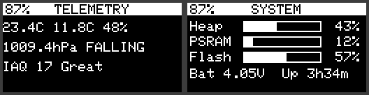

| Gesture | Normal screen | Submenu open |
|---|---|---|
| **1P** — short press | Next page | Next submenu option |
| **LP** — long press | Opens the page submenu | Runs the highlighted option |
| **2P** — double press | Classic configuration menu | Closes the submenu |
| **3 or 4 presses** | WiFi AP menu (as in the original Tracker) | — |
| **5 short, or SOS in Morse** | Emergency beacon (§16) | — |

With a keyboard (T-Deck, etc.) the up/down arrows act as previous/next page.

General rules:
- From the **classic menu**, 2P returns to the screens.
- A submenu closes by itself after 10 s without input.
- In lists with a cursor (MESSAGES and STATIONS in *Browse* mode): 1P moves the cursor, LP opens/runs, 2P exits.
- *Display off* (in MAIN) turns the screen off manually; any press turns it back on.

### 2.2 Header and icon bar

- **Header:** battery **%** on the left; the page **title** in the centre; on the right a **tag** that depends on the page (beacon mode, LoRa region, time source, fix type…). If an emergency is in progress, "SOS" blinks there on every page.
- **Icon bar** (bottom): appears when you change page and hides itself after 3 s. It highlights the current page.
- **Short notices** (box in the centre): confirmations such as "Counters reset" or "SOS sent #1".

### 2.3 Welcome screen and mode selector

At boot: the "APRS LoRa+" logo, **CA2RXU** at the top left, the **version** at the top right and your **callsign without SSID** below it.

Then **SELECT MODE** appears (see chapter 19): *APRS LoRa*, *APRS FSK 9600*, *MORSE / CW* or *WSPR beacon*. Short press = next, long press = accept; with no input, after 8 s the last APRS mode used starts.

### 2.4 Page order

MAIN → MESSAGES → LAST APRS → STATIONS → GPS → COMPASS → ALTIMETER → TELEMETRY → CLOCK → LORA → SYSTEM → (back to MAIN). This is the order in both APRS modes. MORSE mode has a single screen (chapter 21).

### 2.5 Settings that are remembered

Stored in flash and kept across reboots: units, coordinate format, heading mode, true/magnetic north, declination, time zone and time format (`/pagesCfg.dat`); GNSS constellations (now in the WebUI GPS section, no longer `/gps_gnss.dat`); LoRa power per profile (`/loraPower.dat`); and the message history (`/aprsMsgLog.txt`). The heard-stations list is **not** saved (it lives in RAM).

---

## 3. MAIN — main screen

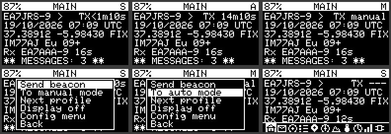

| Row | Content |
|---|---|
| 1 | Callsign and symbol; on the right the **countdown** to the next beacon (`TX 14m10s`; `<` = with SmartBeaconing it may go out earlier; `TX manual`; `TX now`) |
| 2 | UTC date and time |
| 3 | GPS position (`FIX` if there is a fix, `~` if it is the last known one, `WAITING FOR GPS`, `GPS SLEEP`) |
| 4 | 6-character Maidenhead locator, LoRa region (Eu, PL, UK, US, AIS) and satellites with HDOP quality (`+` good, `-` fair, `X` poor) |
| 5 | Last station received and how long ago |
| 6 | `** NEW MSG: n **` if there are unread messages; otherwise altitude, speed and heading |

**Header tag:** **A** = automatic beacons, **S** = SmartBeaconing, **M** = manual.

**Submenu (LP):**
- **Send beacon** — transmits a beacon now.
- **Beacon mode** — toggles between automatic/SmartBeaconing and manual. In manual no automatic beacon is sent.
- **Next profile** — next beacon profile (callsign/SSID).
- **Send SOS** — starts the countdown of the emergency beacon (§16). During an emergency **Cancel SOS** appears first.
- **Display off** — turns the screen off.
- **Config menu** — classic configuration menu.
- **Change mode** — restarts and returns to the mode selector.

---

## 4. MESSAGES

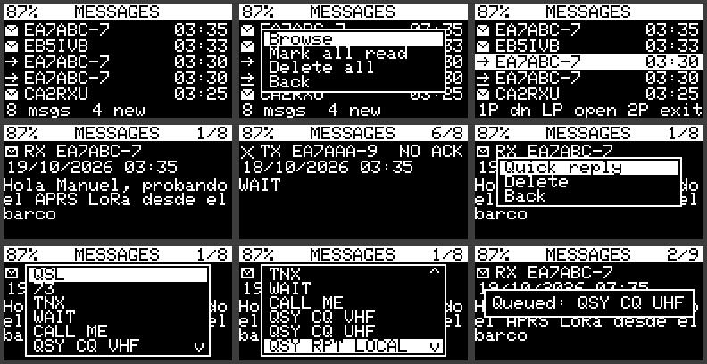

List of **received and sent** messages, newest on top, with time. Icons: envelope = received; arrow = sent; sent ones show whether they were acknowledged or `NO ACK`. At the bottom: total and new. The message LED turns off when you read the pending ones.

**List submenu (5.2.12):** **Read / reply** (opens the newest unread received message right away, or the last received one), *Browse list* (cursor), *Mark all read*, *Delete all*. At the bottom the list shows `N new  Hold: read`. **To answer:** LP (menu) → LP on *Read / reply* → LP (message menu) → *Quick reply* → 1P picks the text → LP sends. It works the same in APRS LoRa and APRS FSK.
**In *Browse*:** 1P moves down, LP opens the message, 2P exits.
**Message detail** (text over several lines): **Reply** (keyboard only: opens the editor with the recipient filled in), **Quick reply**, **Delete**.

**Quick replies:** QSL, 73, TNX, WAIT, CALL ME, QSY CQ VHF, QSY CQ UHF, QSY RPT LOCAL. They are sent **requesting acknowledgement** and appear in the list as sent.

When a message arrives you hear the message beep (if enabled) and the LED blinks until you read it.

---

## 5. LAST APRS — last station heard

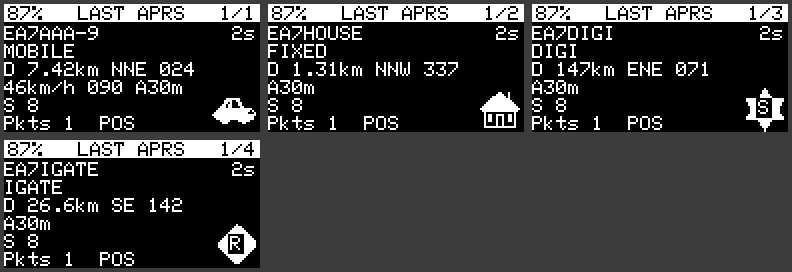

Shows the last station received (you can browse back to earlier ones). It has **two views** (option *Next view*):

- **View 1:** callsign, age, type (MOBILE, FIXED, OBJECT, WX, DIGI, IGATE…), equipment (from the tocall or Mic-E suffix, per the official aprs-deviceid list by Hessu OH7LZB, CC BY-SA 2.0: e.g. *Yaesu FT5D*), distance and bearing from you, and in the bottom-right corner the **APRS icon** of the station symbol (primary and secondary tables, with the overlay letter or digit in the centre; if the station has sent no symbol a mini compass towards it is drawn), speed/heading/altitude if mobile, S-meter (`S 8`, `S 9+10`), packet count and status (for Mic-E: *In Service*, *Emergency!*…).
- **View 2:** callsign, locator, coordinates, full comment (wrapped) and the path (`via WIDE1-1*`). For weather stations it shows T, RH, pressure, wind and rain.

**Submenu:** *Next view*, *Older station*, *Newer station*, **GO TO** (§7), *Back*.

---

## 6. STATIONS — stations heard

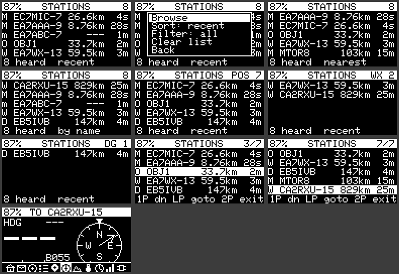

List of up to **20 stations** with a type letter, callsign, distance and age. Letters: **M** mobile, **F** fixed, **O** object, **W** weather, **D** digipeater, **I** iGate, **m** messages only, **s** status, **t** telemetry. The header shows the active filter and the number of stations; the bottom shows the sort order.

**Submenu:**
- **Browse** — cursor over the list (1P moves down, **LP = GO TO** the highlighted station, 2P exits).
- **Sort** — *recent*, *nearest* or *by name*.
- **Filter** — *all*, *position* (only with position), *mobile*, *fixed*, *WX*, *digi*.
- **Clear list** — clears the list.

A packet without position (a message, a status) does **not** erase that station's last known position. Stations without position show `---` as distance.

---

## 7. GO TO — head to a station

GO TO opens **COMPASS** with the station as destination. It can be launched from LAST APRS, from STATIONS (*Browse* mode) and from the emergency alarm screen. The header becomes `TO <callsign>` and the compass shows bearing (`B055`), distance and estimated time of arrival. When you get **within 50 m** a beep sounds; it re-arms when you move away more than 80 m. If the station has no known position, "Station has no position" appears.

---

## 8. GPS

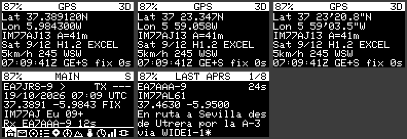

| Row | Content |
|---|---|
| 1 | Latitude (in the chosen format; **DD with 6 decimals** only on this page, 4 elsewhere) |
| 2 | Longitude |
| 3 | 8-character locator and altitude (`A=41m`, barometric or GPS) |
| 4 | Satellites used/seen, HDOP, quality from HDOP (IDEAL, EXCEL, GOOD, MODER, FAIR, POOR) |
| 5 | Speed and heading with cardinal point |
| 6 | UTC time, active constellations (`GE+S` = GPS + Galileo + SBAS) and fix age |

The header shows the fix type (`3D`, `2D`, `NO FIX`).

**Submenu:**
- **GPS on/off** — turns the receiver on or off manually (saves battery).
- **Coords** — format: **DD** (37.389120N), **DDM** (37 23.347N) or **DMS** (37 23'20.8"N).
- **Units** — **metric**, **imperial** or **nautical**. Affects all pages (distances, speeds, altitudes).
- **SBAS** — enables or disables SBAS (EGNOS).
- **Constellations** — GPS, Galileo, BeiDou, GLONASS, QZSS (each can be toggled and is saved).

> Changing constellation restarts the receiver: you may lose the fix for a few seconds. GNSS, SBAS and constellation functions are available on the Supreme's u-blox M10.

---

## 9. COMPASS

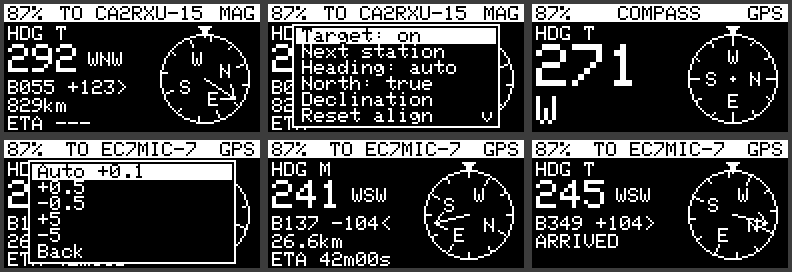

Compass rose with the heading at the top. Without a destination it shows your own heading; with a destination (GO TO or *Target: on*) it also shows an arrow to the station, the **bearing (B)**, the **heading error** relative to your direction (`+123>` turn right, `-104<` turn left), the distance and the **ETA**. `ARRIVED` on arrival.

The heading comes from fusing the **gyroscope**, the **magnetometer** and the **GPS course** (at sufficient speed). The header tag gives the source: `MAG`, `GPS`.

**Submenu:**
- **Target** — enables or disables the destination.
- **Next station** — changes the destination station.
- **Heading** — *auto* (fusion), *MAG* (magnetometer only) or *GPS* (GPS course only).
- **North** — **true** (`T`) or **magnetic** (`M`) north.
- **Declination** — opens a second level: **Auto** mode (**WMM2025** model, using your position and date) or manual, with ±0.5° and ±5° adjustments.
- **Reset align** — forgets the learned magnetometer alignment offset ("Alignment reset").

Automatic declination uses the WMM2025 model (valid until ~2030). Without position or date the manual value is used.

---

## 10. ALTIMETER

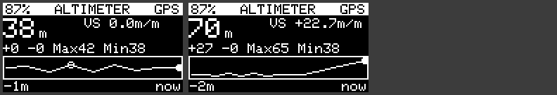

- Large **altitude**, **vertical speed** (`VS -1.1m/m`; with the tracker stopped for more than 10 s, according to the GPS (< 1.5 km/h) or the accelerometer, it shows `VS 0.0m/m` instead of barometer or GPS noise) and **QNH** in use (with `*` if manual).
- Accumulated **ascent/descent** (`+151 -122`) and maximum/minimum (`H56 L-13` or `Max56 Min-7`).
- **Altitude profile**: a graph of several hours in fixed memory (decreasing resolution).
- The header shows the source: `BARO` (barometer corrected with GPS) or `GPS`.

**Submenu:**
- **Span** — *full* (whole profile), *half* (last half) or *10 min*.
- **Reset profile** — clears the altitude profile and starts again.
- **QNH** — second level: **Auto** (learned from GPS) or manual (±1 and ±0.1 hPa; useful to set it from a METAR or a nearby station). Range 900–1090 hPa.

---

## 11. TELEMETRY — weather and forecast

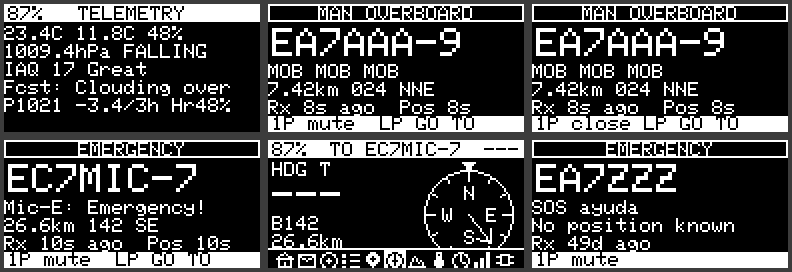

Sensor page (needs **Telemetry** enabled in the web configuration and a BME280, BMP280 or BME680):

| Row | Content |
|---|---|
| 1 | Temperature, dew point, humidity (`23.4°C 11.8°C 48%`, centred) |
| 2 | Pressure and 3 h **barometric trend** (RISING, FALLING…) |
| 3 | Gas and estimated **IAQ**: **shown only with a BME680**; without it the line is hidden and the others move up |
| 4 | **Forecast** (`Fcst: Clouding over`) |
| 5 | Reason: 3 h pressure change (`-3.4 hPa/3h`; `3h trend: wait` without enough history) |
| 6 | **Cloud base** (Hennig, (T−Td)·125 m) and air type (`Cloud 750m Cumulus`); from 18:00 local, if the estimated minimum is ≤ 0 °C, `FROST risk Tmin -1°C` |
| 7 | Without BME680, with falling pressure and base < 600 m: `Fog/rain likely 80%` |

**Rules added (5.2.3):** a decision matrix using pressure, 3 h change and T−Td (strong fall < −1.5 hPa with P < 1010 and T−Td ≤ 3 → *Severe storm*; strong fall with P > 1020 and T−Td > 8 → *Sudden change*; steady ±0.5 with P > 1016 and T−Td > 10 → *Fair, anticyc.*; strong rise > +1.5 with P < 1008 and T−Td ≤ 4 → *Passing showers*), Hennig cloud base, air type from T−Td (≤ 3 saturated; < 10 cumulus; ≥ 12 dry) and night frost `Tmin = T18 − 0.55·(T18 − Td18) − 2` from the 18:00 local sample (needs valid time and the tracker on at that hour; valid 16 h). The Zambretti Z index is not implemented: its condition table was not available.

**How the forecast is computed:** simple rules using pressure (reduced to sea level when the altitude is known), the 3 h trend, humidity and the T−Td difference. Possible results: *Fair, stable*, *Fair*, *Fair, improving*, *Improving*, *Clearing*, *Clearing, windy*, *Little change*, *Overcast, damp*, *Turning cloudy*, *Clouding over*, *Showers possible*, *Rain likely*, *Rain/wind soon*, *Storm/gale risk*, *Fog/dew likely*, *Unsettled*. Until a trend exists (1 h of data) it shows `(trend wait)`.

> It is a **local, indicative** forecast, not a weather model: it does not replace the official forecast or one for sea or mountains.

---

## 12. CLOCK

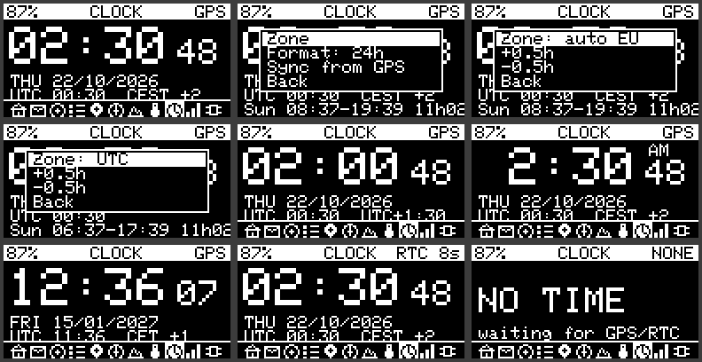

Large local time, seconds, date with weekday, a line with **UTC and zone** (`UTC 00:30  CEST +2`) and **sunrise and sunset** with day length (`Sun 08:37-19:39 11h02`, computed with the NOAA method from your position).

The header shows the time source: `GPS`, `RTC` (with the age of the last sync) or `SYS`. Without valid time `NO TIME` appears.

**Submenu:**
- **Zone** — second level: *auto EU* (CET/CEST with automatic European daylight saving), *UTC* or manual (±0.5 h).
- **Format** — 24 h or 12 h (AM/PM).
- **Sync from GPS** — sets the clock from GPS time; if the GPS has no valid time yet it says "No GPS time".

---

## 13. LORA — radio

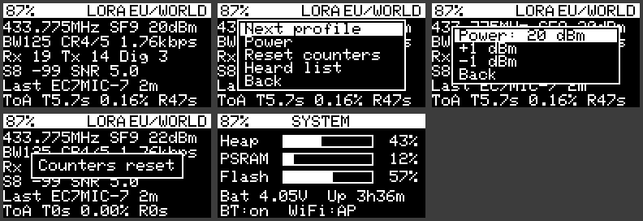

The header shows the **region/profile** (EU/WORLD, POLAND, UK, US, CUSTOM or **AIS**, with fixed frequency).

| Row | Content |
|---|---|
| 1 | Frequency, spreading factor (SF) and **power** (`433.775MHz SF9 20dBm`) |
| 2 | Bandwidth, code rate and computed **useful data rate** (`BW125 CR4/5 1.76kbps`) |
| 3 | Counters `Rx n  Tx n` (and `Dig n` if the digipeater has repeated something) |
| 4 | **S-meter** + RSSI + SNR of the last station (`S8 -99 SNR 5.0`) |
| 5 | Last station received and how long ago |
| 6 | **Time on air** over the last hour: `ToA T5.7s 0.16% R47s` (T = transmitted with its percentage, R = received) |

- **S-meter** (VHF/UHF): S9 = −93 dBm, 6 dB per point (S1 = −141 dBm); above that, `S9+dB`.
- **Time on air:** computed with the Semtech formula from SF, BW, CR and the real length of each frame sent and received. The transmit percentage lets you watch the duty cycle.
- The **data rate** is theoretical (not measured).

**Submenu:**
- **Next profile** — next LoRa profile (EU/WORLD, POLAND, UK, US, CUSTOM). Blocked with a notice while the AIS beacon profile is active.
- **Power** — second level with **+1 dBm** and **−1 dBm** within the board's valid range. It is **saved** per profile and applied at boot.
- **Reset counters** — zeroes Rx, Tx, Dig and time on air.
- **Heard list** — jumps to STATIONS.

> The power chosen here overrides the one in the configuration file for that profile. If you later change it from the web, it has no effect while `/loraPower.dat` exists (delete it or set it again here).
>
> **Bluetooth and WiFi** status is now shown in SYSTEM.

---

## 14. SYSTEM — device status

Gauges for **Heap**, **PSRAM** and **Flash** (percentage of the firmware partition used), battery and **uptime** (`Bat 4.05V  Up 3h36m`; if the board has no PSRAM enabled, the PSRAM row shows `n/a` instead of a percentage; `USB` if there is no battery) and **Bluetooth and WiFi** status (`BT:on  WiFi:CON`; for BT, `CON` = phone connected; for WiFi, `CON` = joined to your network with KISS over WiFi on, `..` = joining, `AP` = configuration access point).

- **1P** (with Bluetooth or WiFi on) toggles to the **LINK view**, which is not a separate page: it shows Bluetooth (type, KISS/TNC2 protocol, name and whether a phone is connected) and WiFi (network, **IP**, KISS ports, connected clients and signal). Another press goes to the next page; **2P** returns to SYSTEM.
- **LP** opens the submenu: **Bluetooth: ON/OFF** and **BT data: KISS/TNC2** (saved, and the board restarts) **WiFi KISS: ON/OFF** and **WiFi CAT: ON/OFF** (applied immediately; the WiFi network is entered in the WebUI).

---

## 15. Received emergency alarms

The Tracker monitors **everything it hears** and raises an alarm if it detects:
- a **Mic-E beacon with Emergency status**;
- the words **SOS**, **EMERGENCY** or **MAYDAY** in a message or comment;
- the words **MOB** or **MAN OVERBOARD**, with any active profile, AIS included.

Detection is by **whole words** ("MOBILE" does not trigger). The Tracker does not decode maritime-radio AIS messages: it reacts to **APRS messages** carrying those words.

**What happens:** the screen turns on; a siren sounds every 2.5 s; the LED blinks fast; and the **alarm screen** appears with the title (`EMERGENCY` or `MAN OVERBOARD`, blinking), the large callsign, the message text, **distance and bearing** (`7.42km 024 NNE`) and the age of the message and of the position.

| Press | Effect |
|---|---|
| **1P** | Silences the buzzer and LED; a second 1P closes the screen |
| **LP** | Silences, closes and does **GO TO** towards the station |
| **2P** | Silences and closes |

- If the message carries no position, the **last known position** of that station in STATIONS is used (with its age). If there is none, it says "No position known" and there is no GO TO.
- The **same station does not sound again** until 10 minutes after its last alarm (its data is still updated).
- The buzzer silences itself after 10 minutes.
- The alarm needs **buzzer and message LED enabled** in the configuration to sound and blink.
- If the classic configuration menu is open, the alarm screen does not appear (the buzzer and LED still work).

---

## 16. Own SOS beacon

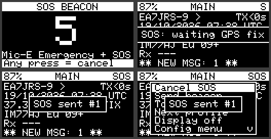

**Activation:** **5 short presses** or **SOS in Morse** (`···  −−−  ···`) with the button. Short press = under 0.3 s; long (dash) = between 0.3 and 0.7 s; no more than 1.2 s between presses. Also from MAIN → LP → **Send SOS**.

**Countdown:** "SOS BEACON" screen with a large 5 and a beep every second. **Any press cancels it.** Otherwise, at 0 the emergency starts.

**What is transmitted** (two packets in a row, 1.5 s apart):
1. a **Mic-E packet with Emergency status** (APRS standard);
2. a normal position beacon with the comment **"EMERGENCY SOS"**, for those who do not interpret Mic-E.

**Repetition:** every **30 s** until cancelled. During the emergency the GPS stays **on** and "SOS" blinks in the header of every page. Each send shows "SOS sent #n". If there is still no known position, it shows "SOS: waiting GPS fix" and retries every 5 s.

**Cancel:** repeat the gesture (5 presses or SOS in Morse) or MAIN → LP → **Cancel SOS**.

Trackers that receive your emergency will show the §15 alarm with GO TO towards you.

> Tested on PC and in simulation. **Not tested with the real button and radio**: do a test first with another device nearby, warning anyone listening, before relying on it.
>
> If you do the gesture slowly, an intermediate menu may briefly open (for example the WiFi AP one with 3 or 4 presses); when SOS is recognised everything returns to MAIN.

---

## 17. Troubleshooting

| Symptom | Likely cause and fix |
|---|---|
| MAIN says `WAITING FOR GPS` | No fix: open sky and wait. If it says `GPS SLEEP`, the GPS is off (eco mode or turned off manually): GPS → LP → *GPS on/off*. |
| TELEMETRY: `Sensor: none/no data` | Enable *Telemetry* in the web configuration and connect the sensor. |
| Forecast "trend wait" | Not enough trend data (one hour minimum, three for the full trend). |
| Compass gives no heading (`no heading`) | Keep the board flat; when stationary the magnetometer is used, when moving the GPS course. *Reset align* if it drifts. |
| Wrong declination | Check that *Declination* is Auto and that you have position and date; otherwise the manual value is used. |
| LORA: cannot change profile | The active beacon profile is **AIS**, which sets its own LoRa profile. Change the beacon profile first. |
| I changed power on the web and it is not applied | The power saved from the screens (`/loraPower.dat`) wins. Adjust it from LORA → Power. |
| No alarm sound | Buzzer and message LED enabled in the configuration; the alarm screen does not appear with the classic menu open. |
| Clock says `NO TIME` | No GPS or RTC with valid time. Wait for a fix or check the RTC battery. |
| Constellations: I lose the fix when changing | Normal: the receiver restarts when the constellation changes. |
| WSPR: "NO GPS TIME" / "WAIT GPS POSITION" | No GPS time or position: open sky. With a fixed locator in the WebUI no position is needed, but time still comes from the GPS. |
| WSPR: nobody decodes me | Calibrate the frequency (22.4), check dial 432.300 MHz USB, the low-pass filter and the antenna. |
| MORSE or FSK missing in the selector | They are only offered with SX1262/SX1268 (MORSE) and without LLCC68 (FSK). |
| "Trainer needs buzzer" | Enable the buzzer in the configuration. |
| "Set key GPIO (WebUI)" | Define the key pin in the WebUI. |

---

## 18. Known limitations and verification status

- The 5.1.0 firmware was **compiled and run by its user on a T-Beam S3 Supreme**. Verified on PC: the pure logic (station list, altitude profile, trend, heading, formats, WMM, time on air, S-meter, forecast, alarm detection, SOS gestures, AX.25/G3RUH, Morse timing and decoding) with unit tests; and the screens in a 128×64 simulator.
- **Not verified on hardware in depth:** FSK reception (experimental) and the CW sidetone on the buzzer (fixed in 5.3.4, still to be tested). AIS and iGate builds have not been recompiled.
- `gps_utils.cpp` (constellations, SBAS, satellites) could not be compiled in the development environment.
- TFT screens (Heltec Wireless Tracker, T-Deck) only passed a syntax check.
- The `HELTEC_WSL_V3_TNC` board has no display.
- The station list is not saved across reboots; positions of APRS **objects** are not shown (the library sets them to zero); Yaesu/Kenwood equipment codes were taken from memory.
- The FIXED/MOBILE label is deduced from speed and symbol.
- Once closed, the alarm screen cannot be reopened.
- The GPS accuracy estimate is a rule of thumb (HDOP × 2.5 m), not a measured value.

---

## 19. Mode selector

After the welcome screen **SELECT MODE** appears. An option is only offered if the radio supports it (FSK does not exist on LLCC68; MORSE requires SX1262/SX1268, like the T-Beam S3 Supreme).

| Mode | Modulation | Screens | Beacons |
|---|---|---|---|
| **APRS LoRa** | LoRa (as always) | the 11 in this manual | automatic |
| **APRS FSK 9600** | FSK G3RUH with AX.25 frames (the AIS profile stays on LoRa) | the same 11 | automatic |
| **MORSE / CW** | LoRa at rest; CW by carrier | only **MORSE** (no icon bar) | manual only |
| **WSPR beacon** | carrier with 4 tones (4-FSK, 1.46 baud) | only **WSPR** (no icon bar) | automatic WSPR beacons; APRS manual |

- **Short press** = next option; **long** = accept. After 8 s without input the last APRS mode used starts.
- MORSE and WSPR are **never saved and never start by themselves**: you must choose them at every boot. The APRS modes never show their screens.
- To change mode: MAIN → LP → **Change mode** (or, in MORSE and WSPR, LP → *Change mode*). The board restarts and asks again.
- If the board has no user button, the last saved mode starts.

> **Each mode transmits only its own signal.** In MORSE/CW, WSPR and LR-FHSS the tracker does not transmit APRS packets: no SOS beacon (the emergency gesture shows "SOS: APRS modes only"), messages, ACKs, digipeater, telemetry or Bluetooth packets. To transmit APRS, reboot and choose an APRS mode.

## 20. APRS FSK 9600 mode (AX.25 G3RUH) and IARU band plan

### 20.1 What is transmitted
Beacons are converted to **AX.25 UI** frames (PID 0xF0) with CRC-16 FCS, HDLC with bit stuffing, NRZI and the **G3RUH** scrambler (x^17 + x^12 + 1), at 9.6 kbps, GFSK BT 0.5 and 3 kHz deviation. The LoRa APRS header `<\xff\x01` is not sent; on reception it is restored internally. The AIS profile remains LoRa.

### 20.2 Compatibility
It is heard by 9600 baud G3RUH packet receivers (TNCs and radios with a 9600 data port). It is **not** heard by analogue 1200 baud APRS (AFSK) equipment.

### 20.2b FX.25 and IL2P (5.3.1)
The **Packet protocol (TX)** selector of each FSK profile chooses how the frame is sent: **AX.25** (plain), **FX.25** (the same frame inside a Reed-Solomon error-correcting block with 16, 32 or 64 check bytes; stations that do not know FX.25 still read the frame) or **IL2P** (compact, with error correction, but only heard by IL2P stations such as Dire Wolf 1.7). Reception understands all three formats at once. FX.25 is the recommended option; frames that do not fit in 255 bytes are sent as plain AX.25. Details and limits in `docs/FSK_G3RUH.md` (Spanish). Tested on air (FX.25 and IL2P).

### 20.3 Parameters (WebUI, per profile)
Bit rate (9.6 kbps), deviation (3.0 kHz) and receive bandwidth (39 kHz). SF, CR and BW only apply to LoRa.

### 20.4 IARU band plan in the WebUI
Each profile has an **IARU region** (1, 2, 3) and an **IARU band plan channel** with the 70 cm digital channels of the IARU R1 / WIA plan and the usual LoRa APRS frequencies. The WebUI warns in red if the frequency falls outside the region's amateur allocation (R1 430–440 MHz; R2 420–450 and 902–928 MHz; R3 430–450 MHz). National rules prevail: the warning is informative and does not prevent saving.

### 20.5 Limitations
- The chip only moves blocks of 255 bytes: preamble of at most ~50 ms and frames up to ~150 bytes.
- Reception decodes 255-byte blocks in software without chip synchronisation. **It is experimental and not verified on real hardware.**
- There is no listen-before-talk (CAD) in FSK.
- q-constructs (`qAR`…) and lower case in callsigns do not exist in AX.25 and are sent in upper case.

### Automatic IARU region
The IARU region (1, 2 or 3) can be chosen automatically from the GPS position: **WebUI > Transmission mode > IARU region (auto)**. Off by default. It sets the region, band plan channel and frequency of every profile (LoRa, FSK, FT8 / FT4 / FST4W and the two CW profiles).
- **When:** *At start-up and on request* (with the region stable for about 20 s) or *also while moving* (when you cross a limit, after 60 s in the new region so it does not flip at a border). On request: the **Detect now** button in the WebUI or **SYSTEM > IARU: detect now** on the tracker screen. A GPS fix is needed.
- **How:** with *Ask on the tracker screen* a window **IARU region N** opens with **Apply** / **Keep current** (1P switches option, LP accepts; with no answer in 30 s it stays as it is). Without it, the frequency is changed directly. If only the region labels change and no frequency does, it is applied without asking.
- **Frequencies:** a band plan channel becomes the equivalent channel of the new region (or that region's default channel when there is none: 433.775 MHz for LoRa and FSK, 432.050 MHz for telegraphy). A **Custom** frequency is kept when it fits the amateur allocation of the new region; otherwise it is replaced by the default channel. FT4 and FST4W frequencies outside the new allocation are cleared (they do not transmit until filled in). WSPR, LR-FHSS, DAPNET and the AIS nautical profile are not touched.
- **Limits:** the ITU ones, simplified (lines A and C and the Region 1 / 3 land border); next to the R1 / R3 land borders they can be off by tens of km. With automatic mode on, a region you set by hand is replaced at the next detection. **National rules always prevail.**

## 21. MORSE / CW mode

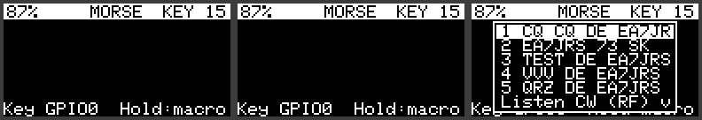

### 21.1 The MORSE screen
Shows the **decoded text** of what you key, listen to or send (sent text is prefixed with `>`), the letter in progress as dots and dashes and, in the header, the key type and speed (`KEY`, `IA`, `IB` + WPM). It is the only screen of the mode: 1P does not change page.

### 21.2 Submenu (LP)
**1–5** send the corresponding macro · **Listen CW (RF)** · **Trainer: listen** · **Trainer: keying** · **CW beacon: ON/OFF** · **Clear text** · **Change mode** · **Back**.

### 21.3 Macros
Five messages editable in the WebUI (LoRa → CW / Morse), with `{CALL}` replaced by your callsign. Defaults: "CQ CQ DE {CALL} {CALL} K", "{CALL} 73 SK", "TEST DE {CALL}", "VVV DE {CALL}", "QRZ DE {CALL} K". A continuous carrier from the SX1262/SX1268 keyed on/off (A1A) is emitted on the active profile's frequency and power; with a CW/SSB receiver you hear the tone. The button aborts. While it lasts, the rest of the Tracker is paused. Speed (5–40 WPM) is set in the WebUI.

### 21.4 Key on a 3.5 mm jack
In the WebUI define the pins: tip = *Key / dit GPIO*, ring = *Dah GPIO*, sleeve = GND (−1 = no key). They are inputs with pull-up (the contact goes to ground); use GPIOs that are free on your board.
- **Straight key**: tip only; adaptive decoder (the configured WPM must be close to yours).
- **Iambic A / B**: tip = dit, ring = dah, with paddle memory. *Swap paddles* for left-handed use.
- *Key the RF carrier*: the key emits the RF carrier live. *Sidetone*: 700 Hz tone on the buzzer (it must be enabled); it sounds with the key, the macros (manual or FH-2 keypad), the trainer and the remote key, not with the autonomous beacon.
- Operating the key with the MORSE screen open starts a session that ends after 2.5 s of inactivity or with the button.

### 21.5 CW listening over RF
Submenu → **Listen CW (RF)**. The chip switches to narrow-band FSK (4.8 kHz) on the profile frequency and the instantaneous RSSI is read (~1 kHz). An envelope detector with adaptive threshold and an adaptive decoder turn it into text (header `RX <wpm>`). The **first line** shows the **S-meter** (VHF/UHF, IARU: S9 = −93 dBm, 6 dB per S-unit, S9+10, +20…), the level in dBm and the SNR; below, the three latest text lines and the letter in progress. The last line shows the **squelch**: **short press** = next value (OFF, −120 … −70 dBm in 5 dB steps), **long press (0.7 s)** = exit and restore the modem. Below the squelch nothing is decoded or drawn (3 dB hysteresis). It can also be set in the submenu (*CW squelch*) and in the WebUI (LoRa → CW / Morse → *CW RX squelch*).
- Designed for a keyed carrier (A1A) within ±2 kHz of the profile frequency. It is not an audio demodulator.
- It needs ≥ 6 dB between carrier and noise; with a weak signal or strong QSB it decodes poorly.
- During listening there is no APRS reception or beaconing.

### 21.6 Autonomous CW beacon
WebUI → CW / Morse: **CW beacon every (min)** (0 = off) and **CW beacon text** with `{CALL}`, `{LOC}` (6-character locator if there is a fix) and `{VBAT}` (volts). Default `DE {CALL}/B {LOC} V{VBAT}` → `DE EA7JRS/B IM77AJ V4.1`. With the interval > 0, in MORSE mode it transmits 10 s after boot and then every interval. Submenu → **CW beacon: ON/OFF** to start or stop it. The button aborts the transmission in progress. The board does not enter deep sleep between beacons.

**CW BEACON screen (5.2.11).** In MORSE mode there are two screens, switched with a short press: **MORSE** (key, listening and trainer) and **CW BEACON**, dedicated to the beacon like WSPR and LR-FHSS. It shows the callsign, speed (WPM), power, the CW Beacon profile frequency with the interval, the expanded beacon text (`{CALL}`, `{LOC}`, `{VBAT}`), the status (`Beacon OFF`, `Next TX mm:ss` countdown, `Sent #n` or `Aborted` for 8 s) and the number of beacons sent. Long press → **Beacon: ON/OFF**, **Send now** (transmits immediately), **Tune carrier** (30 s carrier to measure the frequency, chapter 25), **Change mode** and **Back**. While transmitting you see the "CW TX" screen with the text and a progress bar; the button aborts it. *Not tested on hardware.*

### 21.7 Trainer (Koch method)
They do not transmit RF. In the WebUI you set the **Koch level** (2–41; order K M R S U A P T L O W I . N J E F 0 Y , V G 5 / Q 9 Z H 3 8 B ? 4 2 7 C 1 D 6 X) and the **Farnsworth speed** of the spacing (0 = no Farnsworth); the character speed is the general WPM.
- **Trainer: listen** (buzzer enabled): a group of 5 characters sounds, the screen shows `?????`; after 1.5 s the group is revealed and after 3 s the next one starts. You identify it by ear and compare with what is revealed; it does not count hits. The button exits and shows how many groups you did.
- **Trainer: keying** (key GPIO defined): a large character and its code are shown; you key it, the decoder reads it and shows OK or what you keyed. Top right, hits/attempts. The button exits.

### 21.8 Limits
Only SX1262/SX1268 transmit (without them you can decode and hear the sidetone). PARIS timing, keyer and decoder checked on PC; **tested with a real key (straight and iambic)**.

---

## 22. WSPR beacon mode

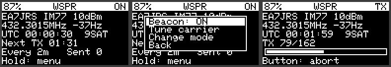

Autonomous WSPR beacon synchronised by GPS. Select it in **SELECT MODE → WSPR beacon** (SX1262/SX1268 only); like MORSE, it is not saved. Its only screen is **WSPR**. Technical sheet in `WSPR.md` (Spanish).

### 22.1 What it transmits
A **type 1** WSPR message: your callsign (without SSID; 6 characters at most, no prefix or suffix such as `/P`), a **4-character locator** and the power, encoded as 162 4-FSK symbols at 1.4648 baud with 1.4648 Hz tone spacing. It lasts 110.6 s and starts 1 s after the even minute. Time comes from the GPS (nothing is sent without valid time). The locator is taken from the GPS position at each transmission (a "tracker" beacon), or is the fixed one you enter in the WebUI.

### 22.2 Configuration (WebUI → CW / Morse → WSPR beacon)
| Field | Meaning |
|---|---|
| Fixed centre (Hz) | **Fixed**, not editable: dial 432.300 MHz USB + 1500 Hz = `432301500` |
| Frequency offset (Hz) | Measured oscillator correction (see 22.4) |
| Power | 0, 3, 7, 10, 13, 17 or 20 dBm: the message power and the radio power (default 10 dBm) |
| Transmit | One transmission every 2, 4, 6, 10, 12, 20, 30 or 60 min; the offset within the cycle depends on the callsign |
| Fixed locator | 4 characters; empty = from GPS |
| Fine tone spacing | Sends each symbol in two segments (two neighbouring 0.954 Hz PLL steps, a single change mid-symbol) to approximate the 1.4648 Hz spacing. On by default |
| Screen off while transmitting | Turns the screen off during the transmission (less power and heat next to the TCXO). Off by default |
| Drift compensation (0.1 Hz/min) | Frequency ramp during the transmission, centred on its midpoint (the calibrated centre does not change). Positive = frequency rises. To cancel a −4 Hz/min drift reported by WSJT-X: `+40`. 0 = off (default). See `WSPR_CALIBRACION.md` |
| Per-power calibration table | When enabled, the offset and the drift compensation come from a table with one row per power (0, 3, 7, 10, 13, 17 and 20 dBm) and the two general fields are ignored. Calibrate each row once at that power. With no saved table, the rows start from the general values |

### 22.3 The screen
Callsign, locator and power; frequency and offset; UTC time and satellites; **countdown** to the next transmission (or `TX n/162` with a progress bar); interval and transmissions sent. **LP** opens the submenu: **Beacon: ON/OFF**, **Tune carrier**, **Change mode**, **Back**. The button aborts a transmission (or a Tune) and leaves the beacon OFF. While transmitting, the rest of the Tracker is paused.

### 22.4 Frequency calibration (essential)
WSPR only decodes if the signal is within ±100 Hz of the centre (±0.23 ppm at 432 MHz). The SX1262 TCXO has a typical tolerance of ±1 to ±2 ppm (hundreds of Hz) and drifts with temperature, so **you must calibrate**:
1. Submenu → **Tune carrier** (30 s of unmodulated carrier on the centre frequency).
2. Measure the frequency with an SDR and compute `offset = nominal − measured` in Hz.
3. Enter it in *Frequency offset* and repeat with the board at working temperature.
Even so, thermal drift can move the signal out of the window: a large ΔF in wsprnet.org spots shows it.

### 22.5 Hardware and safety
- The carrier is on 92 % of the time (110.6 s out of every 120 s): start with low power and watch the SX1262 temperature.
- SX1262 harmonics require a **70 cm low-pass filter** before the antenna.
- Amateur bands only and with your licence; national rules prevail.

### 22.6 Limits
Type 1 messages only (no prefixes/suffixes or 6-character locator). Time accuracy ≈ ±0.3 s (enough for WSPR). No deep sleep between transmissions. The encoder is verified on PC against a reference implementation; **real transmission, tone switching during TX and frequency drift have not been tested on hardware**.

---

## 23. Reorganised WebUI (5.2.11)

The **CONFIGURATION** menu of the WebUI is now: Beaconing, Station, **GPS**, **Transmission mode**, Connectivity, Hardware, Telemetry, Administration and About.

### 23.1 Beaconing
The "Beacon" block is now called **Beacon User Profile** (per-callsign user profile: SSID, symbol, comment, SmartBeacon and LoRa profile).

### 23.2 GPS
Applied at start-up (saving restarts the device). The module type is detected automatically.

| Setting | u-blox M10 | L76K |
|---|---|---|
| GPS, Galileo, BeiDou, GLONASS, QZSS, SBAS constellations | Yes (SBAS and QZSS need GPS; BeiDou and GLONASS cannot be used together; at least one of GPS/Galileo/BeiDou/GLONASS) | GPS, BeiDou and GLONASS only (QZSS always on, no Galileo) |
| SBAS options (differential corrections, ranging, integrity) | Yes | No |
| AssistNow Autonomous (offline A-GPS) | Yes | No |
| Dynamic model, minimum elevation, static hold | Yes | No |
| Update rate | 0.1–2 Hz | 1, 2, 4 or 5 Hz (module maximum) |
| PPS output (frequency, length, edge, cable and user delay) | Yes | No |

On other boards the section reads "Not configurable". The L76K commands (CASIC `$PCAS`) come from the manufacturer documentation and are **not verified on hardware**. *Disable GPS* stays in Station. Constellations are no longer stored in `/gps_gnss.dat` but in the configuration.

**Quectel L76K features (CASIC, AT6558R chip)** — enabled automatically when the module speaks NMEA but does not answer UBX:

- **Constellations** (`$PCAS04`): GPS, BeiDou and GLONASS in any combination (including BeiDou + GLONASS, which the M10 does not allow). It has its own mask (`cnMask`), so changing module does not overwrite the M10 one. QZSS is always on; the L76K supports neither Galileo nor SBAS.
- **Rate** (`$PCAS02`): 1, 2, 4 or 5 Hz. Above 1 Hz the serial port moves from 9600 to 115200 baud by itself (`$PCAS01`) and is kept only if valid frames arrive; otherwise it goes back to the previous speed.
- **Reduced NMEA output** (`$PCAS03`, *Reduced NMEA output* box, on by default): only GGA, RMC, GSV and antenna status; GSV is sent less often above 1 Hz. Less traffic and CPU load.
- **Antenna status** (`$GPTXT … ANTENNA OK/OPEN/SHORT`): logged only when it changes and shown in the WebUI GPS section (no antenna, or shorted antenna).
- **Eco mode**: if the receiver's power is cut at rest, on wake-up the baud rate is detected and the receiver is configured again.
- Satellites in view: BeiDou `BDGSV` sentences are counted too.
- There are no verified equivalents of dynamic model, static hold, AssistNow or PPS configuration (the pulse is fixed, 100 ms, rising edge): those settings are dimmed.
- On the device's GPS screen, Galileo, SBAS and QZSS report that they cannot be changed on the L76K.

The PC test covers the commands against the manufacturer's examples (checksums) and the parsing of `GPTXT` and `BDGSV` with the TinyGPS++ library. A test on a real board is still missing.

### 23.3 Transmission mode
"LoRa" is now called **Transmission mode**, with one group per mode:
- **APRS LoRa:** 4 regional profiles (EU/WORLD, Poland, UK, US) plus the AIS nautical profile (editable frequency; SF 9 and CR 4/5 fixed). IARU region, channel, frequency, SF, CR, BW and power. **Listen before transmitting** (formerly CAD): see 23.4.
- **APRS FSK:** as an analogue mode, each profile (1 and 2) has its **own** IARU region, channel, frequency and power, plus bit rate, deviation and receive bandwidth.
- **CW Beacon:** two radio profiles, each with IARU region, channel, frequency and power: **1) CW Beacon** (autonomous beacon) and **2) Telegraphy** (key, messages, trainer and CW listening). The device switches between them automatically.
- **WSPR Beacon:** the frequency is **fixed** (432 301 500 Hz) and cannot be changed; offset, power, interval, locator and calibration options are set.
- **LR-FHSS Beacon (experimental):** **reserved** group. The transmitter code is in the firmware but switched off until its use is authorised (see `LRFHSS_BALIZA.md`).

### 23.4 Listen before transmitting (CAD)
- **LoRa:** CAD; the device waits for the channel to be free for 2 slots (DIFS) and then a random backoff. Each time the channel is busy the window doubles (4, 8, 16, 32 slots).
- **FSK:** carrier sense by RSSI (SX1262/SX1268); the channel is busy above **FSK busy above** (−95 dBm by default).
- **Max wait for a free channel:** 1–60 s (10 by default); the packet is sent anyway once it expires. A chip error counts as a free channel.

## 24. APRS bell rings on a passive buzzer (5.2.11)

With a passive buzzer (e.g. **KY-006**) the Tracker can play "APRS bell ring" melodies inspired by the *List of APRS Bell Rings* table in the Yaesu FTM-400DR APRS manual: *ding* = high note, *dong* = low note. Enable it in WebUI → Notification → **APRS bell rings** (on by default; the buzzer must be enabled). When off, the usual beeps return.

| Event | Melody | Triggered by |
|---|---|---|
| Bulletin (BLN/NWS) received | ding ding ding ding ding dong | message from another station addressed to BLN or NWS |
| Message to my callsign | ding ding ding dong | received message addressed to me |
| REJ received | ding (lower) | `rej` reply to a message of mine |
| ACK received | ding | `ack` reply to a message of mine |
| Beacon received | ding dong | station heard |
| Message to another station | ding | message with a different addressee |
| Duplicate message | ding ding (eighth notes) | same message within 15 s |
| Duplicate beacon | ding (eighth note) | same beacon within 15 s |
| Beacon or message sent | ding | own transmission |

- If two melodies overlap, the higher priority (table order) wins; an equal or lower one does not interrupt the one playing.
- Playback is **non-blocking**: the display and the radio keep working while it plays.
- Duplicates only sound when "station beep" is enabled.
- **Pitches are approximate**: the Yaesu manual gives musical notation only, not frequencies. They can be tuned in `include/bell_rings.h` (`BELL_TABLE`).
- KY-006 wiring: S → buzzer tone pin, middle → buzzer Vcc pin (the firmware powers it only while playing), − → GND. Pins are set in the Notification section. If your module has a transistor and needs 5 V, use the appropriate supply pin of your board.
- **Not tested on hardware** (only the note player, on a PC).

## 25. Global frequency calibration (5.2.11)

The SX1262 oscillator (TCXO or crystal) is off by an amount **proportional to frequency** (ppm), the same in every mode. One setting corrects it: WebUI → Transmission mode → **Frequency calibration** → **Correction (ppm)** (−50 to +50, **three decimals**; positive ppm = the transmitted frequency goes up). It applies to **transmit and receive** in APRS LoRa, APRS FSK, CW/Morse (including listening) and LR-FHSS (reserved).

**How to calibrate**
1. Set the correction to 0 and save. Power on and wait 10 minutes with the case closed.
2. Emit a carrier: **Tune carrier** in the submenu of the **CW BEACON** screen (CW Beacon profile frequency + current correction) or of **WSPR**. It lasts 30 s or until the button is pressed.
3. Measure the frequency with an SDR with a reliable reference (GPSDO), as in `docs/WSPR_CALIBRACION.md`. Error = measured − expected (Hz).
4. In the WebUI enter the measurement frequency in "Measured at (MHz)" and the error in "Error (Hz)", then press **Apply to ppm**: it adds `−error / frequency` (Hz ÷ MHz = ppm). Save. Repeat three times and use the average.
5. Verify with another carrier: it should be within about 20 Hz at 433 MHz.

**WSPR.** It keeps its own offset in hertz (1 Hz resolution). If you enable "Use the global frequency correction (ppm)", WSPR uses the global ppm instead of that offset (0.001 ppm resolution ≈ 0.4 Hz at 432 MHz; WSPR rounds to whole hertz); the per-power table, if enabled, takes priority. For WSPR within ±2 Hz, the offset in hertz is better.

**Limits.** The tracker cannot measure its own error: an SDR is needed. Thermal drift is not corrected. Since 5.2.12 the frequency is programmed on the SX1262/SX1268 with the exact PLL word (0.954 Hz step), so fine ppm corrections really take effect; before, it went through a `float` with ≈ 30 Hz resolution and small corrections were lost. On SX127x the step is ≈ 61 Hz. With a TCXO the effect is small (tens to hundreds of hertz); on crystal boards it is kilohertz. *Not tested on hardware.*

## 26. DAPNET: POCSAG pager receiver (5.2.11)

**Receive-only** mode for the DAPNET amateur paging network (*Decentralized Amateur Paging Network*, hampager.de). The tracker **never transmits** in this mode: no APRS beacons, SOS or messages. Chosen at boot: **SELECT MODE → DAPNET pager** (not saved as the default mode, like MORSE and WSPR).

**How it works.** The SX1262 is set to FSK at 1200 baud (512 and 2400 also possible), continuous receive and no hardware sync, and delivers the raw bit stream. The POCSAG decoder (`include/pocsag.h`) searches in software for the preamble and the sync word `0x7CD215D8`, applies BCH(31,21) correction of up to 2 bits per word, detects inverted polarity and extracts addresses (RIC = address × 8 + frame), the function and the text (7-bit alphanumeric or BCD numeric). It is the same method already used by APRS FSK 9600.

**DAPNET screen** (header: `RX` listening, `SYNC` when a transmission is detected, `MSG` for 6 s after a new message):
- Row 0: frequency and baud rate. With no messages: filter state (own RICs, monitor mode), "Listening…" and the last time received (`Time … (clock)` if it set the clock).
- With messages: `*1/3 1234560 F3 12s` = message 1 of 3, `*` own (`#` other), RIC, function, age; below it up to 3 text lines (63 visible characters).
- Last row: RSSI, batches received (B), messages (M) and `T` if a time message has arrived.
- Submenu (long press): **Older message**, **Newer message**, **Clear list**, **Monitor all: ON/OFF**, **Change mode**, **Back**. The last 10 messages are kept (RAM only).

**Settings (WebUI → Transmission mode → DAPNET Pager)**
- *Frequency*: 439.9875 MHz by default (the usual DAPNET frequency in Europe, also in Spain). The SX1262 covers 150–960 MHz: the 2 m band (144.8625 MHz) is not possible.
- *Baud rate*: 1200 (DAPNET); *Deviation*: ±4.5 kHz; *Receiver bandwidth*: 14.6 kHz (margin for the oscillator error; use the ppm calibration of chapter 25).
- *My RICs*: up to 8 addresses (0–2097151) separated by commas. Without own RICs only the system RICs are listed (RIC 8 = transmitter identification, and the time RICs).
- *Monitor mode*: list every message heard, not only your own.
- *Time sync*: sets the clock from the DAPNET **UTC** time messages (Skyper 2504, AlphaPOC 216, Swissphone 200, Birdy 2000), only if the GPS has no valid time.
- *Character set*: ASCII or German ISO 646 (DIN 66003: `[ \ ] { | } ~` → Ä Ö Ü ä ö ü ß).

**Alerts.** **Own** messages play the "message to me" melody (chapter 24) and wake the display.

**To be confirmed** (the DAPNET documentation could not be read in full; send me the document and I will adjust): exact transmitter deviation, default character set, RIC ↔ callsign mapping and the exact time-message format (`HHMMSS DDMMYY`, `YYMMDDhhmmss` and 14 digits are accepted). **Not tested on air**: the POCSAG logic is verified on a PC with a synthetic encoder (sync, error correction, polarity, several messages, noise), but real reception with the SX1262 is not.

## 27. GFSK / GMSK per FSK profile and WebUI header (5.2.12)

**Gaussian filter of the FSK transmitter.** Each FSK profile now has a **Modulation / Gaussian filter (TX)** selector (WebUI → Transmission mode → FSK profiles): *GFSK BT 0.5* (default, the G3RUH one, as before), *GMSK BT 0.3*, *GFSK BT 0.7*, *GFSK BT 1.0* or *FSK, no filter*. It is applied to the SX126x transmitter (`setDataShaping`) when the FSK modem is configured and when returning to the profile. **The receiver does not depend on this setting.** For true GMSK (MSK with a Gaussian filter) set the **deviation = bit rate / 4** (2.4 kHz at 9.6 kbps); with the standard G3RUH deviation (3 kHz) the signal is GFSK. If you change the filter, the other end must use the same modulation and a wide enough receive bandwidth. DAPNET (receive-only) uses no filter. *Not tested on air or on a spectrum analyser: check the spectrum with an SDR.*

**WebUI.** The **Quectel L76K** receiver block (reduced NMEA output, antenna status) moves to the **end of the GPS section**, after Navigation and PPS, so the u-blox M10 groups stay together; it is still hidden unless an L76K is detected. The header shows **APRS LoRa+** with `Tracker <version>` below it; the **About** section keeps all the original information (including the CA2RXU credit) and adds one line between the build information and the CA2RXU line: `APRS LoRa+ - by Manuel EA7JRS`. The version in the header is read from the firmware (`/version`), so it cannot go stale.

## 28. Compatibility with the boards of the project (5.2.12)

Everything new in 5.2.11 and 5.2.12 is part of the common firmware and is built for **all** boards in `variants/`; whatever depends on the chip or the board switches itself off, with no change for the others.

| Feature | SX1262 / SX1268 | SX1276 / SX1278 | LLCC68 (E220) |
|---|---|---|---|
| APRS LoRa, ppm calibration, APRS bells, messaging | yes | yes | yes |
| APRS FSK 9600 (G3RUH) | yes | yes | no (LoRa only) |
| GFSK / GMSK (Gaussian filter) | BT 0.3 · 0.5 · 0.7 · 1.0 · none | BT 0.3 · 0.5 · 1.0 · none (BT 0.7 uses 0.5) | no |
| MORSE / CW and WSPR (carrier) | yes | no | no |
| DAPNET (POCSAG receive) | yes | no | no |
| LR-FHSS (reserved, disabled) | yes | no | no |

- **The mode selector** (SELECT MODE) only offers the modes the board's chip can do: on a T-Beam with an SX1278 you will see *APRS LoRa* and *APRS FSK 9600*; with an SX1262/SX1268 all of them, and *LR-FHSS* only if enabled in the WebUI. The WebUI shows every group on every board, but the CW, WSPR, DAPNET and LR-FHSS ones do nothing on chips that do not support them (their texts say so).
- **Boards without a button** (ESP32-C3 SuperMini DIY and heltec_ht-ct62): no boot selector; they always start in the last saved APRS mode.
- **Boards without APRS screens** (Heltec Wireless Stick Lite V3 TNC and any that define `NO_APRS_PAGES`): no on-screen pages or messaging; the other radio features and the WebUI work the same.
- **Different displays:** the new screens (CW BEACON, DAPNET, message list) are drawn on the 128×64 logical canvas the rest already uses, so they work the same on 128×64 OLEDs, the Heltec Wireless Tracker (160×80) and the T-Deck (scaled ×2).
- **Buzzer:** APRS bells play on boards with a passive buzzer configured; on the others they do nothing.
- **Memory:** DAPNET adds about 3 KB of static RAM (220 B decoder + 10 messages) and the new code a few tens of KB of flash; all boards use `huge_app.csv`. When building, check the flash usage of the boards with the least memory.
- **Not built or tested on a board:** I reviewed the code with `-Wall` on a PC (SX1262, SX1278, SX1276 and LLCC68) and with unit tests of the POCSAG decoder, but not with PlatformIO nor on any real board.

## 29. FT8 / FT4 / FST4W beacon and switchable LR-FHSS (5.3.0)

**FT8 beacon / FT4 beacon / FST4W beacon.** Chosen in SELECT MODE (SX1262/SX1268 only) and, like WSPR, not saved. Transmit only; the single screen is the beacon page (countdown, UTC time, satellites). Message "CQ CALL LOCATOR" or free text up to 35 characters. The slot comes from GPS time (FT8 15 s, FT4 7.5 s) and the transmission lasts 12.64 s (FT8) or 5.04 s (FT4). The frequency is the **dial** frequency: tone 0 is sent 1500 Hz above it. FT8 defaults to 432.174 MHz (WSJT-X list); **FT4 has no default and does not transmit until one is entered**. Always pick a channel allowed by the IARU plan of your region and your national rules: the WebUI warns when the segment is for beacons, repeaters or digital voice. The screen is not redrawn while transmitting; the button aborts. **FST4W** sends the 50-bit WSPR message (callsign, 4-character locator and power; power is rounded to 0, 3, 7, 10, 13, 17 or 20 dBm) in 120 s periods (109 s transmission) or 300 s (287 s, experimental), starting 1 s after the period begins. It has no default frequency either. Settings: WebUI → "FT8 / FT4 / FST4W Beacon" card. Not tested on hardware.

**LR-FHSS beacon.** Enabled with the switch on its WebUI card (off by default); it then appears in SELECT MODE. See `LRFHSS_BALIZA.md`. Experimental; the licensee is responsible for the authorisation that national rules require.

Coverage study of every mode: `ESTUDIO_COBERTURA.pdf`. D-Star/DPRS: planned for 5.4.

## 30. Installing and updating the firmware (5.3.1)

**Over USB (all boards).** Open the project page (`https://ea7jrs.github.io/APRS-LoRa-Plus/`) in Chrome or Edge, connect the board, press *Detect board* (reads board and installed version) and then *Install*. Your configuration is kept. If the board does not show up, hold BOOT while plugging it in.

**From the WebUI (only boards with two firmware copies: T-Beam S3 Supreme and T-Beam 1W).** Administration > *Firmware update*: it shows board, version and whether web update is supported.
- *File*: pick the `.bin` for your board and press *Upload and install*. A file for another board is rejected.
- *Over the internet or Bluetooth*: **done by the APRS LoRa+ Android app** (*Firmware* tab): it looks for the published version, downloads it with the phone's internet, checks size and SHA-256 and sends it to the board over Bluetooth. The board downloads nothing by itself (it no longer carries an HTTPS client, which frees flash) and there is no automatic update at start-up.

Classic ESP32, ESP32-C3, Heltec S3 and T3S3 boards have no room for two copies: update them over USB. If an update ever leaves the board unable to start, reinstall over USB.

## 31. Group watch and remote emergency (5.3.2)

APRS LoRa and APRS FSK 9600 modes only. Both are off by default (WebUI → Station → *Group watch & remote emergency*).

**Group watch (like ARTS on the FT-270E).** Enter up to 5 callsigns (without SSID any SSID matches). The **GROUP** page shows each station as *IN* (heard less than *OUT after* minutes ago and, if set, closer than *Max km*) or *OUT*, with its distance or time since last heard. Entering or leaving range shows "IN RNG / OUT RNG callsign" and beeps. After power-up it waits that time before declaring anybody lost.
- **Optional poll:** with *Poll* ≥ 60 s a "ping" message is sent to a station not heard for that long; a tracker with this firmware answers "pong", which counts as heard. Use long intervals (the channel is shared and FSK has no listen-before-talk).

**Using the GROUP page (like the FT5DE "GM" Group Monitor).** Long press opens the submenu:
- **Browse**: a cursor walks through the members (1P next, 2P exit). The bottom line shows bearing, compass point and distance of the selected one. Long press: **GO TO** (opens the compass pointing at that station), **Quick msg** (quick reply to that member only) or **Ping**.
- **Radar**: APL-style view with your position in the centre, north up and each member numbered by bearing and distance (filled circle = IN, hollow = OUT or beyond the scale). The scale is automatic (shown as "A") or fixed from 1 to 500 km: 1P changes it; *Auto scale* resets it.
- **Quick msg: all** sends the quick reply (QSL, 73, TNX…) to every member that is IN, like Yaesu's "SEND to ALL"; **Ping all** pings everybody.
- Members show on the radar and in GO TO once their position has been received. Tested on a board.

**Remote emergency (like EAI).** Set who may start it and a 4–12 character code. From any APRS client, send a message to the tracker: `EAI <code>` starts the SOS beacon (the same as the local emergency, every 30 s with GPS position) for *Duration* minutes, with an audible alarm and no countdown; `EAI STOP <code>` ends it. The tracker replies "EAI ON n min" or "EAI OFF". An unauthorised sender or a wrong code is ignored without reply. The button gesture cancels it.
- The code travels unencrypted: it prevents mistakes, it is not security. Each user must make sure remote control is allowed by their regulations.
- Tested on a board.

## 32. KISS over WiFi (5.3.2)

The board can be a **KISS TNC over WiFi** for programs such as **APRSdroid** (tested on Android: in *Connection protocol* choose the TCP/IP TNC option), Xastir or YAAC. **APRS LoRa** and **APRS FSK 9600** modes only, on **ESP32-S3 / C3** boards (T-Beam S3 Supreme, etc.); classic ESP32 boards and the T-Deck do not include it.

1. In the WebUI, Administration → *Firmware update*, enter the **WiFi** (SSID and password) of your home network or your **phone's hotspot**; it is the same one used for the on-line update.
2. Connectivity → **KISS over WiFi**: turn the switch on (off by default), choose the **TCP port** (8001 by default) and, if you want, a **UDP port** (0 = no UDP). *Allowed addresses* limits who may connect: addresses separated by commas, or a prefix ending in a dot (`192.168.1.` = that whole network); empty = anyone on the network.
3. Save and restart. When it joins the WiFi the screen shows the **IP** and ports for a few seconds; it also answers as `aprs-lora-plus.local`. Type that IP and the port in APRSDroid.

- On FSK the frames a client sends must be valid AX.25 and fit in the FSK packet (otherwise they are dropped and logged); what is heard on FSK is delivered the same way as on LoRa.
- Up to 3 TCP clients at once. They receive the frames heard on the air and the beacons the tracker itself sends; what they send is transmitted over LoRa (KISS setting commands are accepted and ignored). UDP: each datagram carries whole KISS frames and the board answers the last address that wrote to it.
- **Power:** the WiFi stays on and the board does not enter deep sleep.
- **Security:** KISS has no password; anyone allowed can transmit with your callsign. Use it on trusted networks and with the address list.
- With a phone hotspot the IP may change between sessions: read the screen, or use `aprs-lora-plus.local` if your application resolves it. Tested with APRSdroid on Android over TCP in **LoRa and FSK**; UDP untested. The `.local` name (mDNS) works on Windows, macOS and Linux, but **many Android apps do not resolve it**: use the IP shown in the LINK view of SYSTEM. The network host name is `aprs-lora-plus` (applied after a restart).

## 33. CAT over WiFi (Hamlib) (5.3.3)

The board can speak Hamlib's **NET rigctl** protocol (the one `rigctld` uses), so programs such as GPredict, `rigctl` or Hamlib scripts see it as a radio: they read the **frequency**, the **mode** (APRS LoRa or APRS FSK 9600), the **RSSI** and the **power**. **It is not an audio radio**: WSJT-X and fldigi cannot decode or modulate through it; they can only follow the frequency or, with *PTT = beacon*, make the tracker send its APRS beacon. APRS LoRa and APRS FSK modes only, on ESP32-S3 / C3 boards.

1. Enter your WiFi in Administration → *Firmware update* (the same one KISS over WiFi uses).
2. Connectivity → **CAT (Hamlib) over WiFi**: turn the switch on (off by default), choose the **TCP port** (4532), the **tuning window** in kHz (0 = the program cannot change the frequency) and, if you want, the **allowed addresses**. *PTT sends an APRS beacon* makes a Hamlib PTT command send a beacon (off by default).
3. Save and restart (or use **WiFi CAT: ON/OFF** in the SYSTEM submenu, applied immediately). KISS and CAT share the same WiFi link and can be active together.
4. From a computer: `rigctl -m 2 -r aprs-lora-plus.local:4532 f` (model 2 = *NET rigctl*).

- Up to 2 clients. No password: use trusted networks and the address list.
- **Over USB:** the same protocol on the board's USB serial port (115200 baud). Enable *CAT over the USB serial port* in Connectivity > CAT (off by default; applies after a restart). While it is on, the log on that port only shows errors. Hamlib has no serial model for this protocol: use the backend in `tools/hamlib_backend` (model "APRS LoRa+ tracker (USB)", DTR and RTS off so the board does not reset) or talk to the port directly. Not available while the tracker is in deep sleep.
- A frequency change requested over CAT lives in RAM only: it is not saved and is dropped when the profile changes. The AIS profile has a fixed frequency.
- The mode does not change live (it is chosen at start-up).
- Full protocol for anyone writing their own client or a Hamlib *backend*: `docs/CAT_HAMLIB.md`. Tested on a PC with `rigctl` 4.6.5; untested on the board.

## 34. BLE control, RF CW and automatic IARU region (5.3.4)

- **BLE control for the Android app** (APRS LoRa+): a second BLE service next to KISS (which does not change). Status, sensors, GNSS, DAPNET, NMEA, mode and profile change, beacon, messages, CW text and remote key. **It requires PIN pairing** (WebUI → Bluetooth → *Control PIN*, default 123456: change it; changing it forgets the paired phones). Details: `docs/BLE_CONTROL.md`.
- **RF CW listening:** the first line shows S-meter (S9 = −93 dBm), dBm and SNR; adjustable **squelch** (OFF, −120 to −70 dBm). While listening, short press = next squelch and long press (0.7 s) = exit. The buzzer sounds with macros, FH-2, key, trainer and remote key.
- **Automatic IARU region:** works out region 1/2/3 from the GPS and sets region, channel and frequency of the LoRa, FSK, FT8 / FT4 / FST4W and CW profiles. Off by default (WebUI → Transmission mode → *IARU region (auto)*); at boot, on request or while running, with *Apply / Keep current* confirmation or directly.
- **BLE KISS:** the tracker advertises its name again and queues up to 4 frames from the phone.
- Not tested on the board.

## 35. SAT mode, rotor, Android app and less flash (5.3.5)

- **SAT mode** (*Satellites 70cm*, SELECT MODE or BLE): satellite list (70 cm, LoRa / LR-FHSS / TinyGS and Inmarsat), azimuth, elevation, distance, next pass and Doppler. Reception with Doppler (CW, FSK / GMSK, LoRa), transmission with pre-compensation (off by default, only on request and with a real callsign) and a preamp / PA / PTT sequencer. The satellite file (`sats.txt`) is sent by the **Android app** over BLE; the tracker no longer downloads it. Details: `docs/SAT_MODE.md`.
- **Rotor:** `rotctld` client (TCP), GS-232 over Bluetooth SPP and a BLE event for the app. It follows a satellite, the GO TO station, a fixed target (up to 8), **the last APRS station heard with a position** (LoRa or FSK, with callsign filter and speed / course prediction) or **the last CW beacon with a locator**. Azimuth and elevation are computed from the tracker's GPS. WebUI → *Antenna rotor*. The tracker's `rotctld` server serves GPredict.
- **Android app:** controls every function over BLE and shows all the data. **Firmware is updated from the app** (the phone's internet and BLE, boards with a second slot): the tracker no longer has an HTTPS client or WiFi update. The WebUI keeps uploading a `.bin` file. CW listening (`cwrx`), A-GPS for the u-blox M10 and the rotor from the app.
- **u-blox M10 GPS:** the receiver port goes up to 115200 baud at boot (back to 9600 if no valid sentences arrive).
- **Green Rx LED** on by default for beacons and CW (only if the pin is assigned; on the Supreme, IO21).
- **Splash screen** with the new logo (pin with L+ and three waves).
- **Less flash:** the configuration is read and written with a field table and the WebUI is lighter (trimmed Bootstrap, shorter help texts). The T-Beam Supreme goes from 91.1 % to 85.2 % of its application partition.
- **Web installer** with Tracker, Rotor and Gateway launchers (`#rotor`, `#gateway`), all with the same version.
- Not tested on the board.

## 36. T-TWR Plus, satellite groups, AIS and internet weather (5.4.0)

- **LilyGO T-TWR Plus** (environment `lilygo_t_twr_plus`, Rev2.0 and Rev2.1): the radio is the **SA868** FM transceiver (1 W) and the ESP32-S3 does the modem. Modes: **APRS AFSK 1200** (mode 0), **M17** (mode 10: APRS in M17 packets and SMS), **FM voice** (mode 11: VFO on the encoder, 32 memories, CTCSS / DCS, scan, ARTS, EAI, APRS beacons and QSY), DAPNET (144.8625 MHz), CW A1A / MCW, calibration (*Tune carrier*) and the L76K GPS. Details in `T_TWR.md`.
- **T-TWR transmit limits:** receive 136–174 / 400–480 MHz. Transmit only in the amateur bands of the IARU region given by the GPS: Europe (R1) 144–146 and 430–440 MHz, Americas (R2) 144–148 and 430–450 MHz, R3 144–148 and 430–440 MHz; without a position, 144–146 / 430–440 MHz. Fixed in the firmware, no WebUI setting; out of band the PTT shows "No TX: out of band". It can only be widened with an unlock code signed for that unit (MAC).
- **Satellite groups and favourites:** new `sats_all.txt` with every band, CelesTrak groups and CTCSS tones. The app (or the WebUI, downloading in the browser) filters it by groups and favourites down to what fits on the board (900 kB on the T-TWR). Favourites and categories from the SAT menu. On the T-TWR the FM VFO follows the satellite with Doppler and tone, and a message or the position can be sent over APRS via satellite (ISS 145.825 MHz, path `ARISS`). See `SAT_MODE.md`.
- **AIS receiver** (mode 12 *AIS receiver*): channel A 161.975 / B 162.025 MHz or alternating with the T-TWR's SA868; an **external AIS module** on a UART (dAISy, Quark-elec...) on any board; or what the app's RTL-SDR hears. **AIS** page with the list by distance, detail, GO TO, **collision alarm** (CPA / TCPA and guard zone) and **distress alarm** (AIS-SART, MOB, EPIRB), and !AIVDM forwarding to the NMEA output. See `AIS.md`.
- **Internet weather** (downloaded by the app from OpenWeatherMap and / or IQAir with the user's keys): **TELEMETRY** page (marked "NET"), *Update from phone*; the pressure becomes the **altimeter QNH** when there is no manual QNH and none learnt from the GPS in the last 20 min ("QNH 1015N"). Never in weather beacons. The rotor box uses it to park in strong wind.
- **I2C broadcast radio** (any board with a display): RDA5807M, Si4703 or Si4735 (this one also on MW, SW and LW), **BCAST** page with RDS.
- **IL2P at 9600** without the G3RUH scrambler, compatible with Dire Wolf and the NinoTNC.
- **GNSS sky** for the app (satellites, elevation, azimuth, SNR, DOP and error: BLE event `sky`).
- **WebUI and web installer** with the Android app icon in the header.
- Not tested on the board.

## Appendix A — Button map per page

| Page | LP opens | Options |
|---|---|---|
| MAIN | submenu | Send beacon, Beacon mode, Next profile, Send SOS / Cancel SOS, Display off, Config menu, Change mode, Back |
| MESSAGES | submenu | Read / reply, Browse list, Mark all read, Delete all, Back (detail: Reply, Quick reply, Delete, Back) |
| LAST APRS | submenu | Next view, Older station, Newer station, GO TO, Back |
| STATIONS | submenu | Browse, Sort, Filter, Clear list, Back |
| GPS | submenu | GPS on/off, Coords, Units, SBAS, Constellations, Back |
| COMPASS | submenu | Target, Next station, Heading, North, Declination, Reset align, Back |
| ALTIMETER | submenu | Span, Reset profile, QNH, Back |
| TELEMETRY | — | (read only) |
| CLOCK | submenu | Zone, Format, Sync from GPS, Back |
| LORA | submenu | Next profile, Power, Reset counters, Heard list, Back |
| GROUP | submenu | Browse, Radar, Quick msg: all, Ping all, Back (with cursor: GO TO, Quick msg, Ping, Back) |
| SYSTEM | submenu | Bluetooth: ON/OFF, BT data: KISS/TNC2, WiFi KISS: ON/OFF, WiFi CAT: ON/OFF, Back (1P toggles the LINK view when connections are active) |
| WSPR (WSPR mode only) | submenu | Beacon ON/OFF, Tune carrier, Change mode, Back |
| FT8 / FT4 / FST4W (those modes only) | submenu | Beacon ON/OFF, Change mode, Back |
| MORSE (MORSE mode only) | submenu | 1–5 (macros), Listen CW (RF), Trainer: listen, Trainer: keying, CW beacon ON/OFF, Clear text, Change mode, Back |
| CW BEACON (MORSE mode only) | submenu | Beacon ON/OFF, Send now, Tune carrier, Change mode, Back |
| DAPNET (DAPNET mode only) | submenu | Older message, Newer message, Clear list, Monitor all ON/OFF, Change mode, Back |

## Appendix B — New and modified files

**New (5.1.0):** `include/ax25_g3ruh.h`, `src/ax25_g3ruh.cpp`, `include/cw_morse.h`, `src/cw_morse.cpp`, `docs/MODOS.md`, `docs/FSK_G3RUH.md`, `docs/CW_MORSE.md` (Spanish).
**New (5.3.0):** `include/ft_beacon.h`, `src/ft_beacon.cpp`, `lib/ft8lib/`, `docs/ESTUDIO_COBERTURA.md/.pdf`; modified `configuration`, `web_utils`, `sleep_utils`, `pages_utils`, WebUI.
**Modified (5.2.12):** `configuration`, `lora_utils`, `web_utils`, `LoRa_APRS_Tracker.cpp` and the WebUI (GFSK/GMSK, L76K block, header and About).
**New (5.2.11, DAPNET):** `include/pocsag.h`, `include/dapnet_utils.h`, `src/dapnet_utils.cpp`, `tools/test_pocsag.cpp`; modified `configuration`, `lora_utils`, `pages_utils`, `web_utils` and the WebUI.
**New (5.2.11):** `tools/test_lrfhss.cpp`, `include/lrfhss.h`, `src/lrfhss.cpp`, `docs/LRFHSS_BALIZA.md` (restored); modified `configuration`, `gps_utils`, `lora_utils`, `pages_utils`, `web_utils`, `LoRa_APRS_Tracker.cpp` and the WebUI.
**New (5.2.10):** `tools/test_wspr_tones.cpp`; modified `configuration`, `lora_utils`, `pages_utils`, `web_utils`, `wspr` and the WebUI.
**New (5.2.1):** `include/aprs_icons.h` (24×24 1-bit APRS icons generated with `tools/gen_aprs_icons.py` from the iGate aprs-symbols sheets); `pages_core` and `pages_utils` modified.
**New (5.2.0):** `include/wspr.h`, `src/wspr.cpp`, `docs/WSPR.md` (Spanish); modified `configuration`, `lora_utils`, `pages_utils`, `web_utils`, `LoRa_APRS_Tracker.cpp` and the WebUI.
**New (screens):** `include/pages_core.h`, `include/pages_utils.h`, `include/wmm.h`, `include/wmm_coeffs.h`, `src/pages_core.cpp`, `src/pages_utils.cpp`, `src/wmm.cpp`, `tools/wmm_cof_to_header.py`, `docs/`.
**Modified:** `LoRa_APRS_Tracker.cpp`, `baro_utils`, `button_utils`, `display`, `gps_utils`, `keyboard_utils`, `lora_utils`, `mag_utils`, `menu_utils`, `msg_utils`, `notification_utils`, `power_utils`, `sleep_utils`, `station_utils`, `wx_utils` (each in `src/` and `include/`) and `variants/ttgo_t_beam_s3_SUPREME_v3/board_pinout.h`.
**Also modified in 5.1.0:** `configuration`, `lora_utils`, `notification_utils`, `pages_utils`, `web_utils`, `data_embed/index.html`, `data_embed/script.js`.
**Data files in flash:** `/pagesCfg.dat`, `/loraPower.dat`, `/aprsMsgLog.txt`.

## Appendix C — Tools

`tools/wmm_cof_to_header.py` converts the official `WMM.COF` file into `wmm_coeffs.h` (WMM2025 coefficients, epoch 2025.0). When a new model is released, run the script with the new `.COF` and rebuild.
